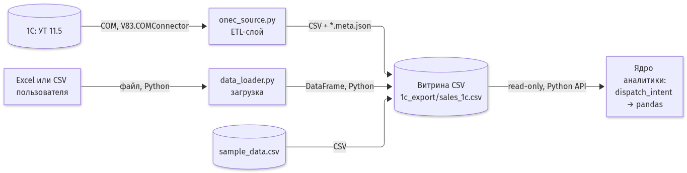
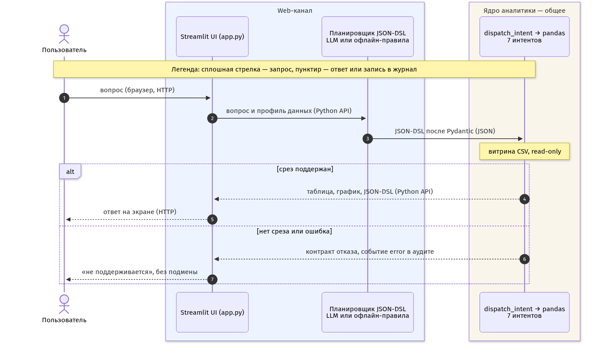
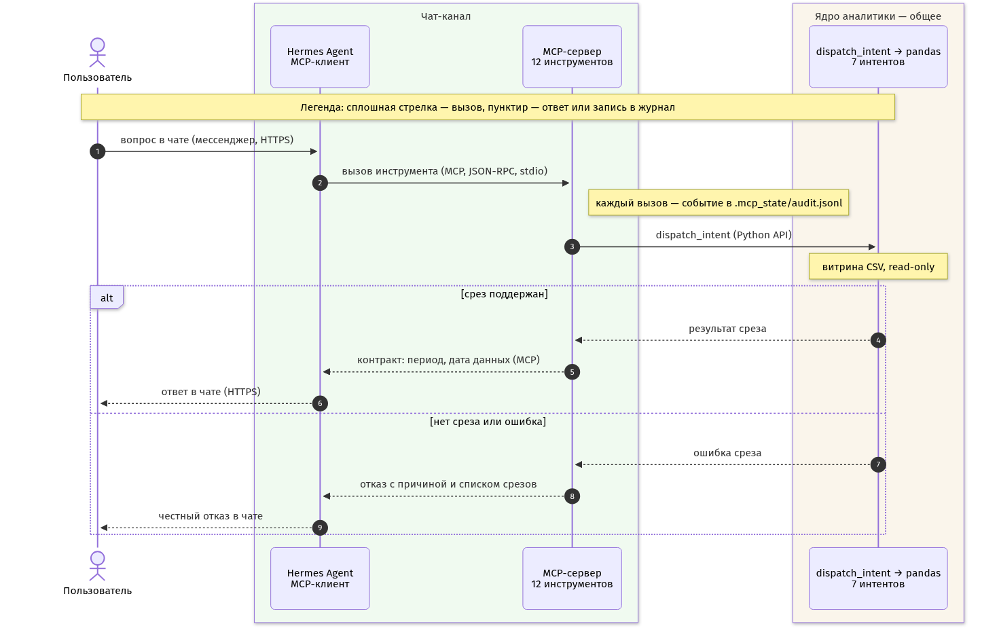

# NL2DSL Аналитик: Интеллектуальный анализ данных из 1С без галлюцинаций LLM


[](https://github.com/Smaturus/1c-ai-analyst/actions/workflows/ci.yml)
[](https://www.python.org/)
[](LICENSE)

**NL2DSL** (Natural Language to Domain-Specific Language) — подход, при котором LLM не считает числа и **не пишет SQL**. Это не NL2SQL: модель переводит вопрос в строгий JSON-DSL, который валидируется Pydantic и исполняется в `pandas`. Точность до копейки и воспроизводимость: понимание вопроса — у модели, расчёты — у детерминированного кода.

## Что смотреть за 3 минуты

1. Поднимите демо: `docker compose up -d --build --wait` → http://localhost:8501 (или `python -m streamlit run app.py`).
2. Задайте три вопроса: «Топ-5 товаров по выручке за 2024», «Сравни топ-5 за 2023 и 2024», «Покажи товары с отрицательной выручкой за 2024».
3. Раскройте «Технические детали» — там JSON-DSL, который исполнил pandas (не ответ модели с цифрами).
4. При желании углубиться: [docs/ARCHITECTURE.md](docs/ARCHITECTURE.md) и [ADR 0004](docs/adr/0004-llm-json-dsl.md) / [ADR 0005](docs/adr/0005-onec-export-split.md).

## Архитектура: данные, общее ядро и два канала

Три представления: как данные попадают в витрину, и как вопрос проходит через каждый канал — web и чат. Исходники схем (mermaid) лежат рядом с картинками: `docs/*.mmd`.

### Поток данных (offline)



*Витрина CSV — единственный контракт между данными и аналитикой. На стрелках подписаны протоколы передачи: COM, файл, CSV и Python API.*

### Web-канал: вопрос в Streamlit UI



*Пользователь вводит вопрос в Streamlit UI (`app.py`), и туда же приходит ответ: таблица, график и JSON-DSL. Ветка `else` — честный отказ вместо подмены и событие `error` в аудите.*

### Чат-канал: вопрос через Hermes Agent



*Агент планирует сам и вызывает уже типизированный инструмент — внутри MCP-сервера LLM нет. Ответ идёт через `answer_contract` (период и дата данных) обратно в тот же чат; каждый вызов подтверждается записью в `.mcp_state/audit.jsonl`.*

Это не монолит «веб-приложение с коннектом к 1С»: данные готовятся офлайн (Data Snapshot), а ответ считает **одно детерминированное ядро** — и для веб-интерфейса, и для агента в чате. Планирование есть только в UI-пути; агент вызывает уже типизированный инструмент. LLM не получает строки витрины и не считает суммы: её выход — только JSON-DSL, который валидирует Pydantic с `extra="forbid"`, а каждый вызов агента подтверждается записью в `.mcp_state/audit.jsonl`.

### 1. ETL-слой — `onec_source.py`

Программный код, который выполняется на машине с 1С:

- подключается к базе через `V83.COMConnector`;
- читает регистр накопления «Выручка и себестоимость продаж»;
- обогащает данные иерархией справочника «Номенклатура» (товарные группы);
- формирует плоскую витрину `1c_export/sales_1c.csv` с предсказуемой схемой.

Требования: Windows, установленная платформа «1С:Предприятие 8.3» (8.3.23+), `pywin32` и действующая лицензия 1С. Для разработки рекомендуется бесплатная Комьюнити-лицензия; подробнее — [docs/RUNBOOK.md](docs/RUNBOOK.md).

### 2. UI-слой — `app.py` + Docker

Веб-интерфейс читает готовый снимок данных (Data Snapshot) и работает поверх pandas:

- Streamlit UI: выбор источника, вопрос, таблица, график Altair, сводка, JSON-DSL;
- источники: демо-данные, снимок 1С, загрузка собственного CSV/Excel;
- запускается в Docker на Linux или Windows **без установленной 1С и `pywin32`**;
- в образ входит только синтетический `sample_data.csv`, реальные выгрузки не публикуются.

> **Публикуется только `app.py`.** Локальная версия интерфейса — `app_local.py` — в
> репозиторий не входит и **никогда не должна попасть в GitHub**: ни в рабочее
> дерево, ни в историю. Единственное её отличие — кнопка «Обновить данные из 1С» с
> обвязкой (выгрузка снимка, дата последнего обновления, тост); всё остальное
> дублируется в `app.py`.

### 3. LLM-слой — провайдеры и выбор модели

Планировщик работает с любым из провайдеров, переключатель — в сайдбаре:

- **DeepSeek / OpenAI / Ollama** — OpenAI-совместимый протокол, модель возвращает JSON-DSL;
- **GigaChat (Сбер)** — двухшаговый OAuth (`authorization key` + `scope`), TLS с доверием к корню НУЦ Минцифры, вместо `response_format` — **tool calling**: модель выбирает функцию-интент, а её аргументы валидируются тем же Pydantic-контрактом ([ADR 0012](docs/adr/0012-gigachat-provider.md)); в LangGraph-агенте GigaChat подключается через официальную `langchain-gigachat`, модель берётся только из настроек (`model=settings.model`) — без хардкода и автоподбора ([ADR 0014](docs/adr/0014-gigachat-langchain.md));
- без ключа — офлайн-правила (`RuleBasedPlanner`): приложение остаётся полностью работоспособным.

У GigaChat в сайдбаре есть список **«Модель GigaChat»**: он строится из фактического
`GET /v1/models` этого ключа (модели эмбеддингов отфильтрованы по типу) и действует
только в текущей сессии — выбор не записывается в `.env`. Настроенные провайдеры
держатся одновременно: собственные ключи `LLM_API_KEY_<PROVIDER>` живут рядом с
общими `LLM_*` провайдера по умолчанию, поэтому DeepSeek и GigaChat доступны в
одном запуске.

Проверка связки «ключ + сертификат + модель» — живыми запросами, но без траты токенов:

```powershell
$env:PYTHONPATH = "src"
python -m onec_analyst.llm_agent --check
```

### Контракт данных

Слои связаны только файлом-снимком и его схемой:

- `1c_export/sales_1c.csv` — витрина продаж: дата, товар, товарная группа, контрагент, количество, выручка без НДС и с НДС;
- `1c_export/nomenclature_1c.csv` — справочник номенклатуры и иерархия товарных групп;
- `sample_data.csv` — синтетический аналог витрины для демо и тестов;
- пользовательский CSV/Excel — приводится к той же схеме при загрузке через UI.

`app.py` не содержит COM-кода и не знает, откуда появился CSV. Замена источника не меняет аналитику: `load_vitrina` приводит файл к единой схеме, а `onec_analyst.analytics` работает уже с ней.

### Почему нет прямого live-подключения из UI

Прямой коннект веб-интерфейса к 1С — антипаттерн:

- падение или блокировка базы 1С останавливает дашборд;
- пароли и учётные данные 1С оказываются в веб-приложении;
- теряется кроссплатформенность: Docker/CI/демо требуют Windows и лицензию 1С;
- результаты перестают быть воспроизводимыми — данные меняются между запросами.

Поэтому выбран паттерн **Data Snapshot** ([ADR 0005](docs/adr/0005-onec-export-split.md)): ETL и UI разделены, обновление снимка — отдельная операция. В публичной версии UI (`app.py`) кнопки live-обновления нет; актуальность данных определяется запуском `onec_source.py` или планировщиком.

## Возможности

Семь интентов:

1. Топ/антитоп товаров за период.
2. Сравнение топов двух периодов (L4L): кто вошёл в топ, кто выпал, кто поднялся или опустился.
3. Отрицательная выручка / возвраты — агрегат по товарам или контрагентам (красные бары).
4. Динамика контрагентов между двумя периодами.
5. Временной ряд продаж (день/неделя/месяц/квартал/год).
6. Срез по товарным группам между периодами.
7. Общая сумма за период.

Поддерживается фильтрация по конкретному товару (`product_filter`) и товарной группе (`group_filter`), а также защита от выгрузки всей базы (лимиты).

## Как это работает

1. Пользователь задаёт вопрос на естественном языке.
2. LLM (DeepSeek/OpenAI/Ollama/GigaChat) или офлайн-правила переводят его в JSON-DSL.
3. Pydantic проверяет структуру и запрещает лишние параметры.
4. `dispatch_intent` вызывает чистую функцию в `onec_analyst.analytics`.
5. pandas считает результат, UI показывает таблицу, график и объяснение.

**Ввод вопроса.** Вопрос отправляется кнопкой «Спросить» или клавишей **Enter** (поле и кнопка находятся внутри формы, поэтому Enter работает как отправка; кнопка «✖️» только очищает поле и вопрос не отправляет). Если вопрос неоднозначный, приложение показывает кликабельные варианты — **Quick Replies** (`st.pills`): выбор подставляет текст в поле и отправляет вопрос автоматически. Текст выбирается умно: если вариант уточнения сам по себе полный вопрос — в поле остаётся только он, если это фрагмент («2024 год») — склеивается с исходным вопросом. После двух уточнений подряд срабатывает **graceful degradation**: выполняется детерминированная ближайшая интерпретация, а над результатом появляется честная плашка «Уточнения исчерпаны — показываю как понял…» ([ADR 0007](docs/adr/0007-graceful-degradation.md)).

## Быстрый старт

### Сценарий А. Демо-режим

Нужен только Docker Desktop. 1С, лицензия и реальные данные не требуются:

```bash
git clone https://github.com/Smaturus/1c-ai-analyst.git
cd 1c-ai-analyst
docker compose up -d --build --wait
```

Интерфейс: **http://localhost:8501**. Внутри — синтетический `sample_data.csv` (600 строк, вымышленные товары и контрагенты). Остановка:

```bash
docker compose down
```

Для старого Docker Compose v1: `docker-compose up -d --build` (без `--wait`).

### Сценарий Б. Работа с реальной 1С

1. Установите платформу 1С 8.3.23+ и получите лицензию — рекомендуется бесплатная **Комьюнити-лицензия** с `developer.1c.ru`.
2. Подготовьте окружение и `.env` (ключи LLM не обязательны — без них работает офлайн-режим):

   ```powershell
   git clone https://github.com/Smaturus/1c-ai-analyst.git
   cd 1c-ai-analyst
   python -m venv .venv
   .venv\Scripts\Activate.ps1
   python -m pip install -r requirements.txt
   python -m pip install -e .
   Copy-Item .env.example .env
   ```

3. Сделайте снимок данных из своей базы (параметры подключения передаются аргументами; пароль не коммитится):

   ```powershell
   python -m onec_analyst.onec_source --base "<путь к вашей базе 1С>" `
     --usr "<пользователь>" --pwd "<пароль>" `
     --out-dir .\1c_export `
     --start 2022-01-01 --end 2024-12-31
   ```

   Без `--start`/`--end` выгружается вся история базы: в демо-базе это 3859 записей
   за 2021-09-01 … 2026-01-20 (27 465 893,44 ₽ без НДС) против эталонных 2568 записей
   и 19 313 936,63 ₽ за 2022–2024. Оба режима и ожидаемый вывод — в
   [docs/RUNBOOK.md §3.3](docs/RUNBOOK.md#33-команда).

4. Запустите UI и выберите в сайдбаре **«1C: 1c_export/sales_1c.csv»**:

   ```powershell
   python -m streamlit run app.py
   ```

Для Docker-запуска с реальным снимком смонтируйте его в контейнер:

```yaml
volumes:
  - ./:/app/data
  - ./1c_export:/app/1c_export:ro
```

### Обновление снимка

- **Вручную:** повторно запустите `onec_source.py`; приложение подхватит новый файл при следующем запросе (кеш привязан к времени изменения файла).
- **По расписанию:** Планировщик задач Windows (Task Scheduler) или Cron на машине с 1С. Пример: `update_1c.bat` с командой выгрузки, ежедневный запуск в 02:00. UI при этом остаётся переносимым и просто читает последний снимок.

## MCP-сервер (интеграция с ИИ-агентом)

Помимо Streamlit, движок доступен через MCP — стандартный протокол инструментов
для агентов (Hermes Agent, любые MCP-клиенты). Сервер намеренно тонкий:

- **12 прикладных инструментов** (`total`, `top_bottom_products`,
  `compare_top_products`, `negative_revenue`, `timeseries`,
  `counterparty_dynamics`, `group_dynamics`, `returns_alert`,
  `load_dataset`, `describe_dataset`, `describe_capabilities`,
  `list_dimensions`) — итого 12 инструментов; методы протокола `resources`/`prompts`
  реализует SDK, инструментами они не являются;
- каждый ответ несёт **период и дату данных**, при отсутствии среза — отказ,
  а не похожий ответ; числа считает только движок;
- JSONL-аудит вызовов, read-only доступ к витрине, kill switch алертов.

Запуск из корня репозитория:

```powershell
python -m onec_analyst.mcp_server
```

Архитектура решения со схемами (C4/ArchiMate):
[docs/ARCHITECTURE-SOLUTION.md](docs/ARCHITECTURE-SOLUTION.md).

## Инженерные решения

- **875 pytest-тестов** в `tests/` и CI на GitHub Actions (Python 3.12): расчёты, планировщик, LangGraph-агент, UI через `AppTest`, лимиты LLM, eval (GoldSet/кассеты/replay); плюс `ruff` и `mypy`.
- **Защита от галлюцинаций LLM:** жёсткий JSON-DSL, Pydantic-модели с `extra="forbid"`, `dispatch_intent`, никаких чисел или SQL от модели.
- **LangGraph-агент ([ADR 0013](docs/adr/0013-langgraph-hybrid-contract.md)):** вопрос идёт через граф `resolve_context → agent_decision → validate_dsl → fix_dsl → clarify/refuse`; нативные tool calls из Pydantic-схем ([ADR 0015](docs/adr/0015-native-tools-audit.md)); GigaChat — через `langchain-gigachat` ([ADR 0014](docs/adr/0014-gigachat-langchain.md)); каждый шаг пишется в `.mcp_state/audit.jsonl`.
- **Eval-слой ([docs/EVAL.md](docs/EVAL.md)):** GoldSet из 50 кейсов, кассеты + replay (регрессия пайплайна), live-прогон живой модели и LLM-as-judge — измерение качества DSL/статусов/факт-чека без правки GoldSet под модель.
- **Rate Limiting ([rate_limiter.py](rate_limiter.py)):** 15 успешных **вызовов** LLM на сессию и 100 в день глобально (SQLite, атомарный резерв `try_consume`); счёт считается на каждый вызов графа, сетевой сбой лимит не съедает; при исчерпании — fallback в правила без обращения к API; ручной сброс сессии только при `RATE_LIMIT_ALLOW_RESET=1` ([LLM_CALLS.md](docs/LLM_CALLS.md)).
- **Graceful degradation ([ADR 0007](docs/adr/0007-graceful-degradation.md)):** неоднозначный вопрос уточняется максимум дважды, затем выполняется детерминированная ближайшая интерпретация с честной плашкой «Уточнения исчерпаны — показываю как понял…»; если разобрать нельзя — понятная ошибка вместо падения. Составной запрос «топ за 2023 и за 2024» поддерживается отдельным интентом сравнения топов (L4L, [ADR 0008](docs/adr/0008-compare-tops-intent.md)): одна таблица с местами, дельтой и статусами — без multi-intent.
- **Разделение ETL и UI (Data Snapshot):** аналитика и дашборд не зависят от доступности 1С; результаты воспроизводимы, тесты не требуют живой базы.
- **Контейнеризация:** `Dockerfile`, `docker-compose.yml`, `.dockerignore`; образ запускается на Linux и Windows без 1С.
- **Безопасность:** пароли 1С не попадают в UI и репозиторий; `.env` и реальные выгрузки исключены через `.gitignore`; в публичном репозитории — только синтетические данные.
- **Устойчивость UI:** если файла 1С нет, приложение показывает предупреждение и продолжает работать с демо-данными или загруженным файлом.

## Безопасность и надёжность

- **Строгая валидация DSL:** Pydantic-модели с `extra="forbid"` и `dispatch_intent` — LLM не может передать неизвестный интент/параметр или «сырое» число вместо параметра.
- **LLM не считает числа:** все суммы, ранги и дельты считает pandas; модель только заполняет JSON-DSL.
- **Честные отказы вместо галлюцинаций:** на неподдерживаемые запросы («средний чек», «средняя выручка») возвращается `clarification` с объяснением, а не подмена топом; при отсутствии данных — сообщение с доступным диапазоном дат.
- **Лимиты LLM:** 15 вызовов на сессию и 100 в день глобально (per-call, §4.2); при исчерпании — офлайн-режим и баннер; ручной сброс — только с `RATE_LIMIT_ALLOW_RESET=1`.
- **Данные и секреты:** в репозитории только синтетика; `.env`, реальные выгрузки 1С, локальная база, сертификат НУЦ и файлы стресс-тестов исключены через `.gitignore`.
- **Ключи не публикуются:** ключи LLM живут только в локальном `.env`; файл не отслеживается git, в истории репозитория ключей нет (проверяется по всем blob-объектам). Локальная версия UI `app_local.py` в GitHub не попадает никогда — публикуется только `app.py`.

## Стек

| Слой | Технологии |
|---|---|
| UI | Streamlit, Altair |
| Аналитика | pandas, numpy |
| Контракт LLM | Pydantic v2, JSON-DSL |
| LLM | OpenAI-совместимый протокол: DeepSeek, OpenAI, Ollama; GigaChat (OAuth 2.0, TLS НУЦ, tool calling); офлайн-правила |
| ETL 1С | `V83.COMConnector`, `pywin32` (только Windows) |
| Инфраструктура | Docker, GitHub Actions, pytest |

## Проверки

```powershell
python -m pytest -q          # 875 passed, 1 skipped
python smoke_test.py         # SMOKE TEST PASSED
python smoke_llm.py          # SMOKE LLM PASSED: 95 проверок
ruff check src               # линтер
mypy                         # типы
$env:PYTHONPATH = "src"
python -m onec_analyst.llm_agent --check   # живая проверка провайдеров, без траты токенов
```

Примеры вопросов:

```text
Топ-5 товаров по выручке за 2024 год
Сравни топ-5 товаров за 2023 и 2024 годы
Покажи товары с отрицательной выручкой за 2024 год
Какие 5 товаров продаются хуже остальных за 2024 год?
Динамика продаж по месяцам за 2023
У каких контрагентов упали продажи в 2024 по сравнению с 2023?
Сколько мы продали за 2024 год?
```

## Документация

Навигация: [docs/INDEX.md](docs/INDEX.md).

- [docs/ARCHITECTURE.md](docs/ARCHITECTURE.md) — компоненты и потоки данных (актуальная спецификация).
- [docs/DATA_CONTRACT.md](docs/DATA_CONTRACT.md) — схема витрины и CSV.
- [docs/LLM_CALLS.md](docs/LLM_CALLS.md) — все LLM-вызовы, per-call лимиты (§4.2), аудит, fallback.
- [docs/EVAL.md](docs/EVAL.md) — eval-слой: кассеты, replay, live, judge, метрики и пороги.
- [docs/RUNBOOK.md](docs/RUNBOOK.md) — запуск, выгрузка 1С, лицензии, типовые ошибки.
- [docs/UI_ACCEPTANCE.md](docs/UI_ACCEPTANCE.md) — приёмка UI и контрольные вопросы.
- [docs/adr/](docs/adr/) — архитектурные решения (в т.ч. Data Snapshot, graceful degradation, L4L, LangGraph).

## Лицензия и данные

Код распространяется по лицензии [MIT](LICENSE). Демонстрационные данные (`sample_data.csv`) синтетические и не содержат коммерческой информации. Реальные выгрузки 1С в публичный репозиторий не включаются. Проект не является официальным продуктом фирмы «1С» и не связан с ней.
