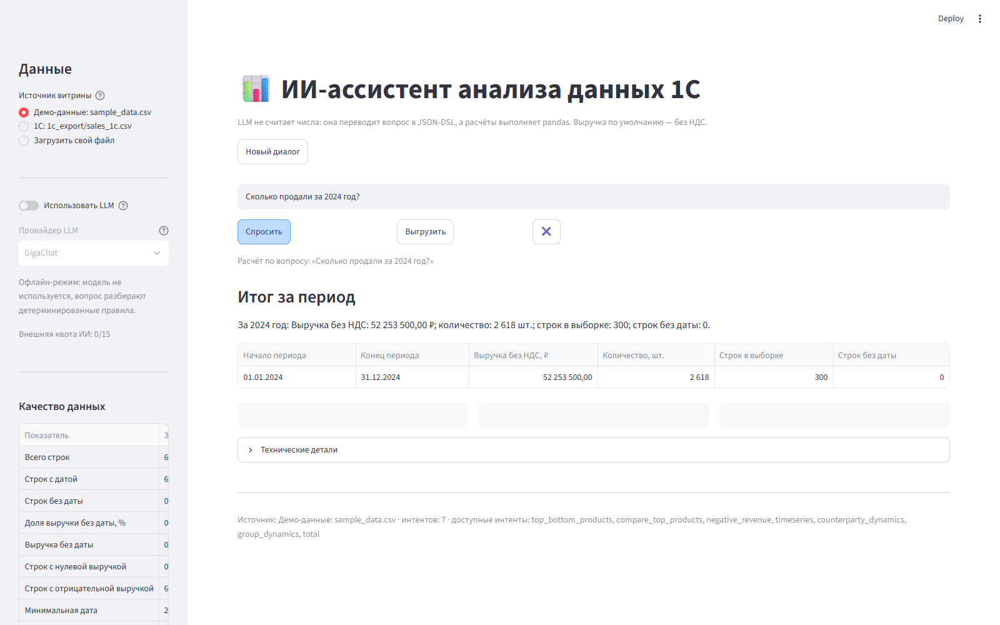
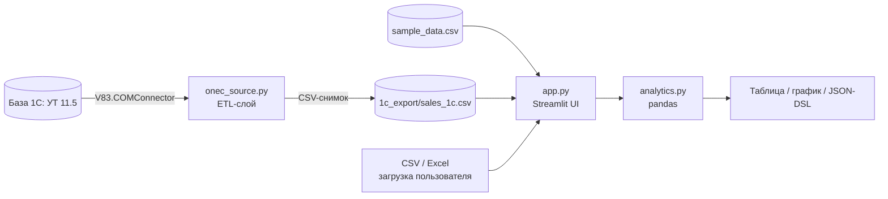

# NL2DSL Аналитик: Интеллектуальный анализ данных из 1С без галлюцинаций LLM



[](https://github.com/Smaturus/1c-ai-analyst/actions/workflows/ci.yml)
[](https://www.python.org/)
[](LICENSE)

**NL2DSL** (Natural Language to Domain-Specific Language) — подход, при котором LLM не считает числа и не пишет SQL. Она переводит вопрос на естественном языке в строгий JSON-DSL, который валидируется Pydantic и безопасно исполняется в `pandas`. Это даёт точность до копейки и воспроизводимость результата: модель отвечает за понимание вопроса, а расчёты — за детерминированный код.

## Архитектура: два независимых слоя



Это не монолит «веб-приложение с коннектом к 1С», а два слоя с явным контрактом данных — паттерн, типичный для Enterprise-разработки.

### 1. ETL-слой — `onec_source.py`

Программный код, который выполняется на машине с 1С:

- подключается к базе через `V83.COMConnector`;
- читает регистр накопления «Выручка и себестоимость продаж»;
- обогащает данные иерархией справочника «Номенклатура» (товарные группы);
- формирует плоскую витрину `1c_export/sales_1c.csv` с предсказуемой схемой.

Требования: Windows, установленная платформа «1С:Предприятие 8.3» (8.3.23+), `pywin32` и действующая лицензия 1С. Для разработки рекомендуется бесплатная Комьюнити-лицензия; подробнее — [docs/RUNBOOK.md](docs/RUNBOOK.md).

### 2. UI-слой — `app.py` + Docker

Веб-интерфейс читает готовый снимок данных (Data Snapshot) и работает поверх pandas:

- Streamlit UI: выбор источника, вопрос, таблица, график Altair, сводка, JSON-DSL;
- источники: демо-данные, снимок 1С, загрузка собственного CSV/Excel;
- запускается в Docker на Linux или Windows **без установленной 1С и `pywin32`**;
- в образ входит только синтетический `sample_data.csv`, реальные выгрузки не публикуются.

### Контракт данных

Слои связаны только файлом-снимком и его схемой:

- `1c_export/sales_1c.csv` — витрина продаж: дата, товар, товарная группа, контрагент, количество, выручка без НДС и с НДС;
- `1c_export/nomenclature_1c.csv` — справочник номенклатуры и иерархия товарных групп;
- `sample_data.csv` — синтетический аналог витрины для демо и тестов;
- пользовательский CSV/Excel — приводится к той же схеме при загрузке через UI.

`app.py` не содержит COM-кода и не знает, откуда появился CSV. Замена источника не меняет аналитику: `load_vitrina` приводит файл к единой схеме, а `analytics.py` работает уже с ней.

### Почему нет прямого live-подключения из UI

Прямой коннект веб-интерфейса к 1С — антипаттерн:

- падение или блокировка базы 1С останавливает дашборд;
- пароли и учётные данные 1С оказываются в веб-приложении;
- теряется кроссплатформенность: Docker/CI/демо требуют Windows и лицензию 1С;
- результаты перестают быть воспроизводимыми — данные меняются между запросами.

Поэтому выбран паттерн **Data Snapshot** ([ADR 0005](docs/adr/0005-onec-export-split.md)): ETL и UI разделены, обновление снимка — отдельная операция. Кнопки live-обновления в UI нет; актуальность данных определяется запуском `onec_source.py` или планировщиком.

## Как это работает

1. Пользователь задаёт вопрос на естественном языке.
2. LLM (DeepSeek/OpenAI/Ollama) или офлайн-правила переводят его в JSON-DSL.
3. Pydantic проверяет структуру и запрещает лишние параметры.
4. `dispatch_intent` вызывает чистую функцию `analytics.py`.
5. pandas считает результат, UI показывает таблицу, график и объяснение.

**Ввод вопроса.** Вопрос отправляется кнопкой «Спросить» или клавишей **Enter** (поле и кнопка находятся внутри формы, поэтому Enter работает как отправка; кнопка «✖️» только очищает поле и вопрос не отправляет). Если вопрос неоднозначный, приложение показывает кликабельные варианты — **Quick Replies** (`st.pills`): выбор подставляет текст в поле и отправляет вопрос автоматически. Текст выбирается умно: если вариант уточнения сам по себе полный вопрос — в поле остаётся только он, если это фрагмент («2024 год») — склеивается с исходным вопросом. После двух уточнений подряд срабатывает **graceful degradation**: выполняется детерминированная ближайшая интерпретация, а над результатом появляется честная плашка «Уточнения исчерпаны — показываю как понял…» ([ADR 0007](docs/adr/0007-graceful-degradation.md)).

Шесть интентов: топ/антитоп товаров, сравнение топов двух периодов (L4L: кто вошёл/выпал/поднялся), динамика контрагентов, временной ряд, срез по товарным группам, общая сумма за период.

## Быстрый старт

### Сценарий А. Демо-режим

Нужен только Docker Desktop. 1С, лицензия и реальные данные не требуются:

```bash
git clone https://github.com/Smaturus/1c-ai-analyst.git
cd 1c-ai-analyst
docker compose up -d --build --wait
```

Интерфейс: **http://localhost:8501**. Внутри — синтетический `sample_data.csv` (600 строк, вымышленные товары и контрагенты). Остановка:

```bash
docker compose down
```

Для старого Docker Compose v1: `docker-compose up -d --build` (без `--wait`).

### Сценарий Б. Работа с реальной 1С

1. Установите платформу 1С 8.3.23+ и получите лицензию — рекомендуется бесплатная **Комьюнити-лицензия** с `developer.1c.ru`.
2. Подготовьте окружение и `.env` (ключи LLM не обязательны — без них работает офлайн-режим):

   ```powershell
   git clone https://github.com/Smaturus/1c-ai-analyst.git
   cd 1c-ai-analyst
   python -m venv .venv
   .venv\Scripts\Activate.ps1
   python -m pip install -r requirements.txt
   Copy-Item .env.example .env
   ```

3. Сделайте снимок данных из своей базы (параметры подключения передаются аргументами; пароль не коммитится):

   ```powershell
   python onec_source.py --base "<путь к вашей базе 1С>" `
     --usr "<пользователь>" --pwd "<пароль>" `
     --out-dir .\1c_export `
     --start 2022-01-01 --end 2024-12-31
   ```

4. Запустите UI и выберите в сайдбаре **«1C: 1c_export/sales_1c.csv»**:

   ```powershell
   python -m streamlit run app.py
   ```

Для Docker-запуска с реальным снимком смонтируйте его в контейнер:

```yaml
volumes:
  - ./:/app/data
  - ./1c_export:/app/1c_export:ro
```

### Обновление снимка

- **Вручную:** повторно запустите `onec_source.py`; приложение подхватит новый файл при следующем запросе (кеш привязан к времени изменения файла).
- **По расписанию:** Планировщик задач Windows (Task Scheduler) или Cron на машине с 1С. Пример: `update_1c.bat` с командой выгрузки, ежедневный запуск в 02:00. UI при этом остаётся переносимым и просто читает последний снимок.

## Инженерные решения

- **194 pytest-теста** в `tests/` и CI на GitHub Actions (Python 3.12): расчёты, планировщик, UI через `AppTest`, статическая проверка app.py.
- **Защита от галлюцинаций LLM:** жёсткий JSON-DSL, Pydantic-модели с `extra="forbid"`, `dispatch_intent`, никаких чисел или SQL от модели.
- **Graceful degradation ([ADR 0007](docs/adr/0007-graceful-degradation.md)):** неоднозначный вопрос уточняется максимум дважды, затем выполняется детерминированная ближайшая интерпретация с честной плашкой «Уточнения исчерпаны — показываю как понял…»; если разобрать нельзя — понятная ошибка вместо падения. Составной запрос «топ за 2023 и за 2024» поддерживается отдельным интентом сравнения топов (L4L, [ADR 0008](docs/adr/0008-compare-tops-intent.md)): одна таблица с местами, дельтой и статусами — без multi-intent.
- **Разделение ETL и UI (Data Snapshot):** аналитика и дашборд не зависят от доступности 1С; результаты воспроизводимы, тесты не требуют живой базы.
- **Контейнеризация:** `Dockerfile`, `docker-compose.yml`, `.dockerignore`; образ запускается на Linux и Windows без 1С.
- **Безопасность:** пароли 1С не попадают в UI и репозиторий; `.env` и реальные выгрузки исключены через `.gitignore`; в публичном репозитории — только синтетические данные.
- **Устойчивость UI:** если файла 1С нет, приложение показывает предупреждение и продолжает работать с демо-данными или загруженным файлом.

## Стек

| Слой | Технологии |
|---|---|
| UI | Streamlit, Altair |
| Аналитика | pandas, numpy |
| Контракт LLM | Pydantic v2, JSON-DSL |
| LLM | OpenAI-совместимый протокол: DeepSeek, OpenAI, Ollama; офлайн-правила |
| ETL 1С | `V83.COMConnector`, `pywin32` (только Windows) |
| Инфраструктура | Docker, GitHub Actions, pytest |

## Проверки

```powershell
python -m pytest -q          # 194 passed
python smoke_test.py         # SMOKE TEST PASSED
python smoke_llm.py          # SMOKE LLM PASSED: 89 проверок
```

Примеры вопросов:

```text
Топ-5 товаров по выручке за 2024 год
Сравни топ-5 товаров за 2023 и 2024 годы
Какие 5 товаров продаются хуже остальных за 2024 год?
Динамика продаж по месяцам за 2023
У каких контрагентов упали продажи в 2024 по сравнению с 2023?
Сколько мы продали за 2024 год?
```

## Документация

- [docs/ARCHITECTURE.md](docs/ARCHITECTURE.md) — компоненты и потоки данных.
- [docs/DATA_CONTRACT.md](docs/DATA_CONTRACT.md) — схема витрины и CSV.
- [docs/RUNBOOK.md](docs/RUNBOOK.md) — запуск, выгрузка 1С, лицензии, типовые ошибки.
- [docs/UI_ACCEPTANCE.md](docs/UI_ACCEPTANCE.md) — приёмка UI и контрольные вопросы.
- [docs/REPORT_STEP3.md](docs/REPORT_STEP3.md) — инкремент UX/CI/относительных дат.
- [docs/REPORT_STEP4.md](docs/REPORT_STEP4.md) — Quick Replies, умный выбор текста, Enter и graceful degradation.
- [docs/adr/0005-onec-export-split.md](docs/adr/0005-onec-export-split.md) — почему ETL отделён от UI.
- [docs/adr/0007-graceful-degradation.md](docs/adr/0007-graceful-degradation.md) — лимит уточнений, fallback и честные плашки.
- [docs/adr/0008-compare-tops-intent.md](docs/adr/0008-compare-tops-intent.md) — интент сравнения топов (L4L) вместо multi-intent.
- Внутренний журнал проекта — `progress.md` (локальный файл, в публичный репозиторий не включается).

## Лицензия и данные

Код распространяется по лицензии [MIT](LICENSE). Демонстрационные данные (`sample_data.csv`) синтетические и не содержат коммерческой информации. Реальные выгрузки 1С в публичный репозиторий не включаются. Проект не является официальным продуктом фирмы «1С» и не связан с ней.
