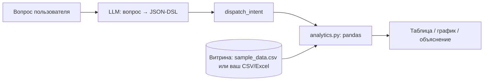

# ИИ-ассистент для анализа данных 1С (MVP)

[](https://github.com/Smaturus/1c-ai-analyst/actions/workflows/ci.yml)
[](https://www.python.org/)
[](LICENSE)

Инструмент, который отвечает на вопросы к данным о продажах на естественном языке. **LLM не считает числа**: она переводит вопрос в строгий JSON-DSL, а расчёты выполняет pandas. Результат — таблица, график и текстовое объяснение.

В репозитории лежат только **синтетические демонстрационные данные** (`sample_data.csv`): реальные выгрузки 1С/Excel в публичный репозиторий не включены. Для работы с реальной 1С её нужно выгрузить самостоятельно через [`onec_source.py`](onec_source.py) (см. ниже).

**Статус:** ✅ шаг 1 (загрузчик + 5 интентов + DSL), шаг 2 (Streamlit UI + Pydantic + LLM-слой) и шаг 3 (UX таблиц/ввода, графики Altair, pytest/CI, относительные даты) — готовы. UI принят через Streamlit `AppTest` и ручную проверку LLM (DeepSeek); тесты — `pytest`, CI на Python 3.12.

## Как это работает



**Пять интентов:** топ/антитоп товаров, динамика контрагентов, временной ряд, срез по товарным группам, общая сумма за период.

## Быстрый старт без 1С

```powershell
git clone https://github.com/Smaturus/1c-ai-analyst.git
cd 1c-ai-analyst
python -m venv .venv

# Windows:
.venv\Scripts\Activate.ps1

python -m pip install -r requirements.txt
python generate_synthetic_data.py   # создаст sample_data.csv
python -m streamlit run app.py      # откроет UI
```

На Linux/macOS активация окружения: `source .venv/bin/activate`.
На Windows также можно просто дважды кликнуть по [`start_app.bat`](start_app.bat) —
он сам создаст `.venv`, поставит зависимости и откроет браузер.

`sample_data.csv` уже лежит в репозитории (600 строк, только вымышленные товары
и контрагенты), поэтому шаг генерации можно пропустить, а при желании —
перегенерировать данные с теми же контрольными суммами:

```bash
python generate_synthetic_data.py
```

Проверка синтетического датасета без UI:

```bash
python smoke_test.py
```

Ожидаемо: `SMOKE TEST PASSED` (схема витрины, контрольные суммы генератора,
5 интентов, DSL-диспетчер и негативные сценарии).

```python
from onec_source import load_sample_vitrina
from analytics import get_top_bottom_products

df = load_sample_vitrina("sample_data.csv")
print(get_top_bottom_products(df, limit=5))
```

## Работа с реальной 1С

Реальные выгрузки **не публикуются** (лицензия 1С). Пользователь делает их
самостоятельно из своей базы:

```powershell
# нужен Python с pywin32 и доступ к базе 1С
python onec_source.py --base "<путь к вашей базе 1С>" --out-dir .\1c_export `
  --start 2022-01-01 --end 2024-12-31
```

```python
from onec_source import load_vitrina

df = load_vitrina("1c_export/sales_1c.csv")   # date, product, counterparty, quantity, revenue, product_group
```

Для ручной загрузки без 1С подойдёт CSV-витрина или Excel «Универсального
отчёта» — кнопка **«Загрузить свой файл»** в сайдбаре. Каталог `1c_export/`,
`тест.xlsx` и `*.1CD` в `.gitignore`.

## UI и LLM-слой

Самый простой запуск на Windows — дважды кликнуть по [`start_app.bat`](start_app.bat): скрипт сам создаст `.venv`, поставит зависимости и откроет браузер.

Вручную (из корня проекта, при активированном `.venv`):

```powershell
python -m pip install -r requirements.txt      # pandas, streamlit, pydantic, pywin32
python -m streamlit run app.py
```

По умолчанию приложение работает **без ключа LLM** — в офлайн-режиме детерминированных правил. Для LLM задайте переменные окружения (см. [`.env.example`](.env.example)):

```powershell
$env:LLM_PROVIDER = "deepseek"          # openai | deepseek | ollama | none
$env:LLM_API_KEY  = "sk-..."
$env:LLM_MODEL    = "deepseek-chat"
python -m streamlit run app.py
```

Офлайн-правила понимают формулировки без слова «продажи» — например, «Динамика по месяцам за 2023», «Итог за 2024», «Лидеры по выручке за 2024».

В системный промпт передаётся **текущая дата** и **Few-Shot примеры** с датами, рассчитанными от неё (прошлый/позапрошлый год, март позапрошлого года, сравнение двух относительных лет) — это закрепляет арифметику сдвига лет. Офлайн-правила понимают те же формулировки (включая «в марте позапрошлого года» и сравнение «прошлый год по сравнению с позапрошлым»), поэтому относительные даты работают и без LLM.

В интерфейсе: поле вопроса с кнопкой очистки **✖️** (форма не отправляется, текст сбрасывается сразу), выбор источника (демо-данные / загрузка файла), переключатель **«Использовать LLM»** (без ключа заблокирован; при выключении вопросы разбирают офлайн-правила без вызовов API), качество данных в сайдбаре, вопрос → LLM (или правила) → Pydantic-валидация → `dispatch_intent` → таблица с русскими заголовками и сортировкой по клику (числа и даты остаются числами и датами), график Altair с русскими осями (горизонтальные бары для топ/динамики, линия для временного ряда), сводка и свёрнутый блок «Технические детали» с JSON-DSL.

Проверка LLM-слоя отдельно (нужен pydantic): [`smoke_llm.py`](smoke_llm.py) — 86 проверок.

## Запуск через Docker

Сборка и запуск через Docker Compose v2 (Docker Desktop):

```bash
docker compose build
docker compose up -d --wait
```

Интерфейс: **http://localhost:8501**

Флаг `--wait` дожидается, пока контейнер перейдёт в состояние `healthy`, —
только после этого имеет смысл открывать UI и дергать `/_stcore/health`.

Остановка:

```bash
docker compose down
```

> Для старого Docker Compose v1 (команда с дефисом) `--wait` недоступен:
> используйте `docker-compose build && docker-compose up -d` и дождитесь
> статуса `healthy` в `docker-compose ps`.

В образ не попадают `.venv/`, `.git/`, `.github/`, `tests/`, `docs/`, `.env`,
реальные выгрузки 1С (`1c_export/`, `*.xlsx`) и кеши — см.
[`.dockerignore`](.dockerignore). Внутри образа: Python 3.12, `build-essential`,
зависимости из `requirements.txt` и синтетический `sample_data.csv`.

`docker-compose.yml` монтирует папку проекта в `/app/data`: свой CSV/Excel можно
положить в проект и загрузить в UI кнопкой **«Загрузить свой файл»**; демо-данные
`sample_data.csv` уже находятся в образе.

Переменные `LLM_PROVIDER`/`LLM_API_KEY`/`LLM_MODEL`/`LLM_BASE_URL` задаются в
`.env` (compose подхватывает его для подстановки) или в окружении хоста. Без
ключа LLM приложение работает в офлайн-режиме правил. Проверка состояния:

```bash
docker compose ps
docker compose logs -f app
docker inspect --format '{{.State.Health.Status}}' 1c-ai-analyst
```

Без Compose:

```bash
docker build -t 1c-ai-analyst:0.5.0 .
docker run --rm -p 8501:8501 --name 1c-ai-analyst 1c-ai-analyst:0.5.0
```

Важно: в Linux-контейнере нет 1С/COM/`pywin32`, поэтому выгрузку из 1С
(`onec_source.py`) выполняйте на Windows-хосте, а готовый CSV/Excel загружайте
в UI.

## Как запустить тесты

Unit-тесты лежат в [`tests/`](tests/) и не требуют ни реальных выгрузок, ни
`sample_data.csv`: синтетическая витрина собирается в
[`tests/conftest.py`](tests/conftest.py). Покрыто 152 теста — расчёты всех пяти
интентов, отрисовка таблиц и графиков, статическая проверка app.py (нет «голых»
строк), разбор вопросов офлайн-планировщиком (включая регрессию «год попал в
limit» и фильтр `only_drops`).

```powershell
# из корня проекта, при активированном .venv
# 1. Поставить зависимости и pytest
python -m pip install -r requirements.txt
python -m pip install pytest

# 2. Запустить тесты
python -m pytest
```

Ожидаемо: `152 passed`. Настройки pytest — в [`pytest.ini`](pytest.ini) (`testpaths = tests`, `pythonpath = .`), при упаковке они же продублированы в [`pyproject.toml`](pyproject.toml).

Быстрый прогон отдельных файлов:

```powershell
python -m pytest tests/test_analytics.py -q   # расчёты на синтетике
python -m pytest tests/test_planner.py -q     # вопрос → JSON-DSL
```

Те же тесты прогоняются в CI: [`.github/workflows/ci.yml`](.github/workflows/ci.yml) на Python 3.12 при push в `main` и в pull request.

## Что уже есть

| Модуль | Назначение |
|---|---|
| [`generate_synthetic_data.py`](generate_synthetic_data.py) | генератор `sample_data.csv` (600 вымышленных строк, 10 % возвратов) |
| [`data_loader.py`](data_loader.py) | ETL Excel-выгрузки «Универсального отчёта» (для своих файлов) |
| [`analytics.py`](analytics.py) | 5 интентов, сравнение периодов, диагностика, JSON-DSL |
| [`onec_source.py`](onec_source.py) | коннектор 1С: выгрузка в CSV, загрузка витрины и демо-данных |
| [`llm_agent.py`](llm_agent.py) | Pydantic-модели DSL, промпт, LLM-клиент, офлайн-правила |
| [`app.py`](app.py) | Streamlit UI: источник, вопрос, таблица, графики Altair, JSON-DSL |
| [`tests/test_analytics.py`](tests/test_analytics.py) | pytest: расчёты 5 интентов на синтетической витрине (26) |
| [`tests/test_planner.py`](tests/test_planner.py) | pytest: офлайн-правила «вопрос → JSON-DSL» (81) |
| [`tests/test_app_display.py`](tests/test_app_display.py) | pytest: заголовки, форматы, сортируемость таблиц, графики (31) |
| [`tests/test_app_planner.py`](tests/test_app_planner.py) | pytest: переключатель LLM (AppTest, 7) |
| [`tests/test_app_question.py`](tests/test_app_question.py) | pytest: поле вопроса и очистка (AppTest, 5) |
| [`tests/test_app_static.py`](tests/test_app_static.py) | pytest: AST-регресс «голых» строк app.py (2) |
| [`smoke_test.py`](smoke_test.py) | сквозной прогон на синтетическом демо-датасете |
| [`smoke_llm.py`](smoke_llm.py) | самопроверка LLM-слоя (Pydantic) |

**Проверенные цифры демо-датасета:**

- 600 строк, 12 вымышленных товаров, 6 контрагентов, 2 товарные группы.
- Период: 01.01.2023 – 28.12.2024; 60 отрицательных строк (10 %) — возвраты.
- Выручка: **99 708 100,00 ₽**, количество: **5 315** шт.
- Все значения детерминированы семенем генератора; `smoke_test.py` сверяет файл с эталоном.

## Ключевые методические решения

1. **Выручка — без НДС** (по умолчанию). С НДС доступна режимом `revenue_mode="gross"`. Почему — [ADR 0001](docs/adr/0001-revenue-net.md).
2. **Источник для периодов — 1С**, Excel — fallback. Почему — [ADR 0002](docs/adr/0002-onec-direct-source.md).
3. **Товарные группы — иерархия справочника «Номенклатура»**. Почему — [ADR 0003](docs/adr/0003-product-groups.md).
4. **Граница LLM → код — JSON-DSL + `dispatch_intent`**. Почему — [ADR 0004](docs/adr/0004-llm-json-dsl.md).
5. **Выгрузка 1С отдельным шагом, CSV как контракт**. Почему — [ADR 0005](docs/adr/0005-onec-export-split.md).

## Структура

```
1c-ai-analyst/
├─ generate_synthetic_data.py # генератор sample_data.csv (без реальных данных 1С)
├─ sample_data.csv            # синтетическая демо-витрина (600 строк)
├─ data_loader.py            # ETL Excel (для загрузки своих файлов)
├─ analytics.py              # 5 интентов + DSL
├─ onec_source.py            # 1С → CSV → pandas + загрузка демо-данных
├─ llm_agent.py              # Pydantic DSL + промпт + LLM/правила
├─ app.py                    # Streamlit UI + графики Altair
├─ start_app.bat             # запуск в один клик (venv + зависимости + браузер)
├─ Dockerfile                # образ Streamlit-приложения (Python 3.12)
├─ docker-compose.yml        # запуск контейнера на порту 8501
├─ .dockerignore             # что не попадает в образ
├─ smoke_test.py             # проверка демо-данных/интентов
├─ smoke_llm.py              # проверка LLM-слоя (Pydantic)
├─ tests/
│  ├─ conftest.py            # синтетическая витрина для тестов
│  ├─ test_analytics.py      # pytest: расчёты интентов (26)
│  ├─ test_planner.py        # pytest: правила → JSON-DSL (81)
│  ├─ test_app_display.py    # pytest: таблицы, форматы, графики (31)
│  ├─ test_app_planner.py    # pytest: переключатель LLM (7)
│  ├─ test_app_question.py   # pytest: поле вопроса (5)
│  └─ test_app_static.py     # pytest: AST-регресс magic-строк app.py (2)
├─ pyproject.toml            # упаковка (PEP 621), зависимости, настройки pytest
├─ pytest.ini                # конфигурация pytest
├─ .github/workflows/ci.yml  # CI: pytest на Python 3.12
├─ LICENSE                   # MIT
├─ requirements.txt          # runtime-зависимости
├─ .env.example              # настройки LLM
├─ docs/
│  ├─ REPORT.md              # итоговый отчёт
│  ├─ REPORT_STEP2.md        # отчёт об инкременте шага 2
│  ├─ REPORT_STEP3.md        # отчёт об инкременте шага 3
│  ├─ UI_ACCEPTANCE.md       # запуск UI и контрольные вопросы
│  ├─ ARCHITECTURE.md        # архитектура
│  ├─ DATA_CONTRACT.md       # контракт витрины и CSV
│  ├─ RUNBOOK.md             # запуск и эксплуатация
│  ├─ ITS_ACCESS_NOTES.md    # доступ к ИТС
│  ├─ INDEX.md               # навигация по документам
│  └─ adr/                   # архитектурные решения
├─ progress.md               # журнал и план
└─ CHANGELOG.md
```

## Документация

- [docs/REPORT.md](docs/REPORT.md) — что сделано, цифры, проверки, ограничения.
- [docs/ARCHITECTURE.md](docs/ARCHITECTURE.md) — компоненты и потоки данных.
- [docs/DATA_CONTRACT.md](docs/DATA_CONTRACT.md) — схема витрины и CSV.
- [docs/RUNBOOK.md](docs/RUNBOOK.md) — команды, типовые ошибки, 1С и лицензия.
- [docs/UI_ACCEPTANCE.md](docs/UI_ACCEPTANCE.md) — запуск UI и 5 контрольных вопросов с ожидаемыми интентами.
- [docs/REPORT_STEP2.md](docs/REPORT_STEP2.md) — отчёт об инкременте шага 2.
- [docs/REPORT_STEP3.md](docs/REPORT_STEP3.md) — отчёт об инкременте шага 3: UX, pytest/CI, относительные даты.
- [docs/ITS_ACCESS_NOTES.md](docs/ITS_ACCESS_NOTES.md) — ИТС: что доступно, что нет.
- [docs/adr/](docs/adr/) — решения с обоснованием.
- [progress.md](progress.md) — статус и план.

## Ограничения

- Демо-данные синтетические: они не воспроизводят реальную номенклатуру и не
  предназначены для выработки бизнес-решений.
- Реальные выгрузки 1С/Excel в репозитории отсутствуют — используйте свой CSV
  (`load_vitrina`) или Excel «Универсального отчёта» через загрузку в UI.
- В Excel-выгрузке возможны строки без даты (в реальных файлах они не попадают
  в аналитику по периодам) — демо-Excel-путь убран из UI, осталась загрузка
  пользовательского файла.
- Документация ИТС по продуктам недоступна (договор `developer.1c.ru`), см. [заметки](docs/ITS_ACCESS_NOTES.md).
- `pywin32` нужен только для выгрузки 1С; unit-тесты и демо-данные работают без него.
- UI проверялся локальным запуском Streamlit (Windows, Python 3.14); CI прогоняет только unit-тесты на Python 3.12 — без браузера и без выгрузки из 1С.

## Лицензия и данные

Код распространяется по лицензии [MIT](LICENSE). Демонстрационные данные
(`sample_data.csv`) являются синтетическими и не содержат коммерческой
информации. Проект не является официальным продуктом фирмы «1С» и не связан с ней.
Реальные выгрузки 1С (`тест.xlsx`, `1c_export/`) в репозиторий не включаются.

### О платформе 1С и данных

Проект не является официальным продуктом фирмы «1С» и не связан с ней. Код
распространяется под лицензией MIT.

Для работы с реальной базой 1С вам потребуется самостоятельно установленная
платформа «1С:Предприятие 8.3» (версия **8.3.23 или новее**). **Рекомендуется
использовать бесплатную Комьюнити-лицензию (Community License)**, которую можно
получить на портале [`developer.1c.ru`](https://developer.1c.ru/). Она не имеет
функциональных ограничений для задач разработки, но не предназначена для
реальной эксплуатации (коммерческого учёта).

**Важно:** Учебная версия платформы (Learning Version) **не поддерживает
COM-соединение**, поэтому для работы скрипта `onec_source.py` необходима именно
Комьюнити-лицензия или коммерческая лицензия.
