# Архитектура решения: MCP-фасад аналитики 1С

| Поле | Значение |
|---|---|
| Документ | Architecture Description (TOGAF ADM Phase C/D) |
| Версия | 1.0 |
| Дата | 13.11.2026 |
| Статус | Draft for review |
| Автор | Команда проекта 1c-ai-analyst |
| Аудитория | архитектор, техлид, ИБ, заказчик (техническая часть) |
| Нотация | ArchiMate 3.2 (Business/Application/Technology) + C4 (context/container/component) + Graphviz (SVG/PNG, исходники `.dot`) |
| Границы | интеграционный контур «1С → витрина → движок → MCP → агент»; Streamlit и ETL — контейнеры того же продукта (см. L2) |
| Не входит | бизнес-кейс, экономика, регламенты заказчика (ведутся отдельно, локально) |

Связанные документы: `docs/ARCHITECTURE.md` (архитектура приложения),
`docs/adr/0004-llm-json-dsl.md` (граница LLM → код), `docs/adr/0008-compare-tops-intent.md`
(сравнение периодов), планируемый ADR 0009 «MCP-фасад над JSON-DSL».

---

## 1. Назначение и рамки (TOGAF Phase A)

**Назначение.** Описать целевую архитектуру, в которой детерминированный движок
аналитики 1С доступен ИИ-агенту (Hermes Agent) через MCP, без потери контракта
«числа считает только движок».

**Драйверы архитектуры**

| ID | Драйвер | Следствие для архитектуры |
|---|---|---|
| D1 | Аналитика должна приходить в рабочий мессенджер, а не в Streamlit | появляется агент-клиент и транспорт MCP |
| D2 | Числа нельзя доверять модели | жёсткий контракт ответа, отказы, аудит |
| D3 | Данные 1С — коммерческая тайна | read-only, allowlist путей, лимиты доступа |
| D4 | Решение должно быть переносимым | MCP как стандарт, агент — сменный клиент |
| D5 | Стоимость и латентность предсказуемы | без второго LLM внутри сервера, детерминированные срезы |

**Ограничения**

- 1С доступна только через COM/выгрузку (Windows); сервер аналитики — без COM.
- MCP-транспорт в v1 — stdio (локальный процесс), состояние витрины — в процессе.
- Модель агента и канал связи выбираются заказчиком (локальная/корпоративная/облако).
- Публичные артефакты не содержат данных заказчика и бизнес-цифр.

## 2. Принципы архитектуры

| ID | Принцип | Реализация |
|---|---|---|
| P1 | Единственный источник чисел — движок | `analytics.dispatch_intent`; сервер не считает «своё», только детерминированные итоги из ответов движка |
| P2 | Контракт важнее удобства | каждый ответ несёт период и дату данных; нет среза — отказ, а не похожий ответ |
| P3 | Модель не вычисляет | проценты/суммы приходят из полей движка или серверных итогов |
| P4 | Read-only по данным | нет записи в 1С, нет SQL, нет произвольных фильтров |
| P5 | Минимальная поверхность | 7 типизированных срезов + метаданные; `execute_dsl` отсутствует намеренно |
| P6 | Наблюдаемость | JSONL-аудит каждого вызова, отказов и загрузок витрины |
| P7 | Сменный клиент | MCP-стандарт; Hermes — первый клиент, не единственный |
| P8 | Отказоустойчивость к данным | дата данных из метаданных выгрузки, fallback — время файла |
| P9 | Безопасность по умолчанию | allowlist путей, отключение terminal/file у агента, лимиты LLM |

## 3. Стейкхолдеры и представления

| Стейкхолдер | Интересы | Представление |
|---|---|---|
| Пользователь | ответ за минуту, честные цифры | Business (UC-1…UC-5), Quality |
| Аналитик | корректность витрины, сверка | Data, Traceability |
| ИТ/ИБ | доступы, канал, хранение | Technology, Security |
| Архитектор/техлид | границы, контракты, эволюция | Application, Component, ADR |
| Разработчик | тестируемость, сопровождаемость | Component, Deployment, Tests |

---

## 4. Бизнес-архитектура (ArchiMate Business Layer)

### 4.1 Элементы

| Элемент | Тип (ArchiMate) | Описание |
|---|---|---|
| Пользователь | Business Actor | инициирует вопросы, получает срезы |
| Аналитик | Business Actor | владелец витрины и сверки |
| ИТ/ИБ | Business Actor | канал, доступы, лицензия |
| Аналитика продаж | Business Service | ответы на вопросы о продажах |
| Контроль возвратов | Business Service | ежедневный алерт и разбор |
| Ответ на вопрос о продажах | Business Process | вопрос → срез → ответ с провенансом |
| Контроль возвратов | Business Process | окно → порог → алерт/тишина |
| Сверка с 1С | Business Process | 30 вопросов → протокол → подпись ФД |
| Отчёт о продажах | Business Object | таблица + период + дата данных |
| Возвраты | Business Object | отрицательная выручка, строки, товары |

### 4.2 Сценарии (use cases)

| ID | Сценарий | Триггер | Результат |
|---|---|---|---|
| UC-1 | Ad-hoc вопрос в чате | сообщение пользователя | ответ с периодом и датой данных |
| UC-2 | Проактивный срез | cron (утро/понедельник) | сообщение с итогами и алертом |
| UC-3 | Смена витрины | «загрузи выгрузку» | переключение срезов без перезапуска |
| UC-4 | Отказ | неподдерживаемый вопрос | отказ + список доступных срезов |
| UC-5 | Сверка | 30 вопросов | протокол приёмки, подписи |

### 4.3 Диаграмма бизнес-слоя

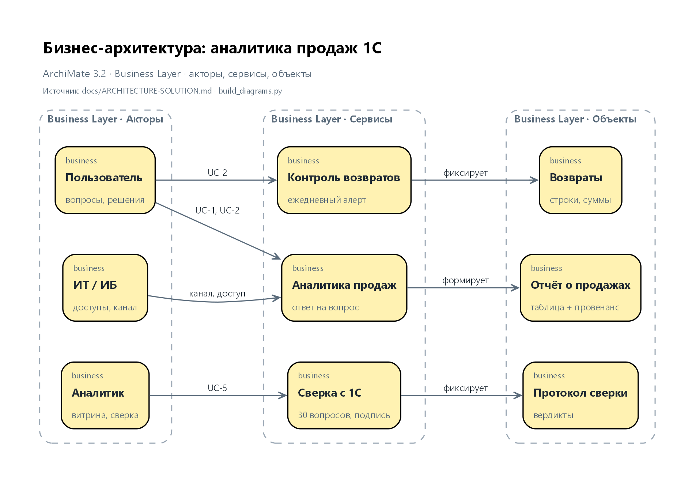

*Вектор: [architecture/01-business-architecture.svg](architecture/01-business-architecture.svg) · исходник: `architecture/src/01-business-architecture.dot`*


---

## 5. Архитектура приложений (ArchiMate Application Layer)

### 5.1 Контекст (C4 Level 1)

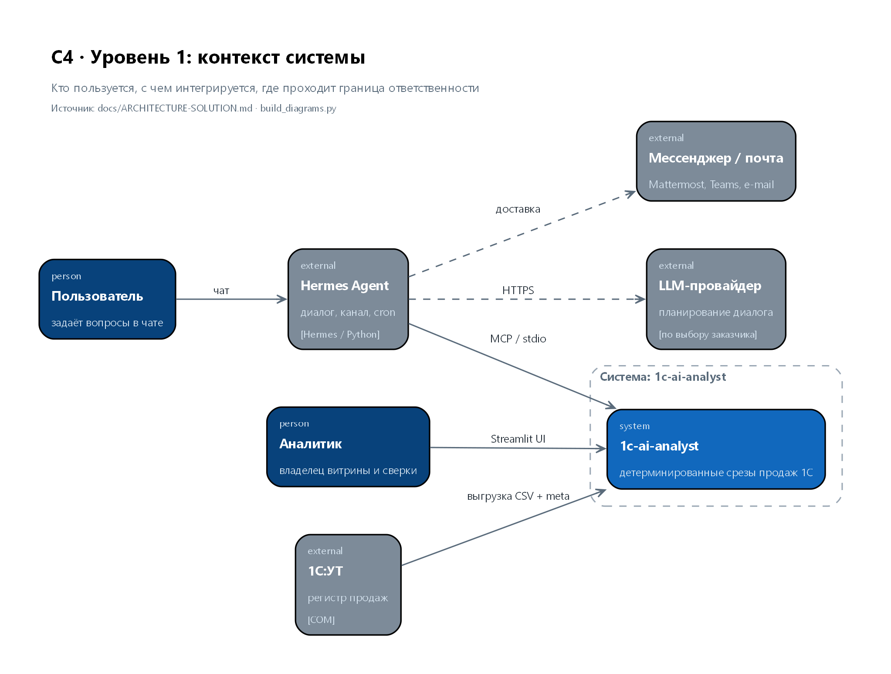

*На L1 внутренние контейнеры не показаны: Streamlit работает с движком напрямую (Python API), MCP-сервер — отдельная точка входа для агента; связи контейнеров — на схеме L2 ниже.*


*Вектор: [architecture/02-system-context.svg](architecture/02-system-context.svg) · исходник: `architecture/src/02-system-context.dot`*


### 5.2 Контейнеры (C4 Level 2)

| Контейнер | Технология | Ответственность | Интерфейсы |
|---|---|---|---|
| Hermes Agent | Hermes Agent (Python), gateway | диалог, канал, cron, память, выбор инструмента | MCP client, мессенджеры |
| MCP Server `1c-analyst` | Python, `mcp` SDK, stdio | типизированные инструменты, контракт ответа, аудит | MCP tools |
| Движок аналитики | pandas, pydantic | 7 срезов, периоды, фильтры, DSL-валидация | Python API |
| Витрина | CSV + `*.meta.json` | данные продаж, дата выгрузки | файловый |
| ETL | `onec_source.py`, COM | выгрузка 1С → CSV, метаданные | CLI/функции |
| Streamlit UI | Streamlit | глубокий интерактивный разбор | Python API |
| Аудит | JSONL | трассировка вызовов и отказов | файловый |

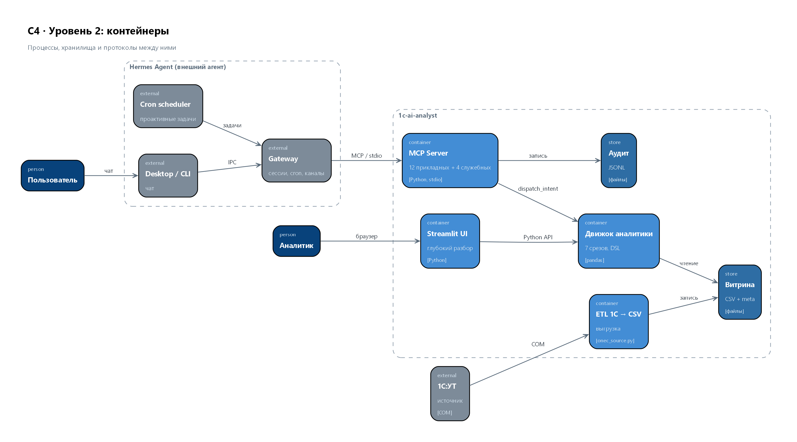

*Вектор: [architecture/03-system-containers.svg](architecture/03-system-containers.svg) · исходник: `architecture/src/03-system-containers.dot`*

### 5.3 Компоненты MCP-сервера (C4 Level 3)

| Компонент | Модуль | Ответственность |
|---|---|---|
| Tool Registry | `mcp_server.py` | 12 прикладных инструментов, схемы аргументов |
| Contract Formatter | `answer_contract.py` | шапка ответа, период, дата данных, отказ, усечение |
| Dataset Store | `mcp_server.py` | текущая витрина, загрузка, allowlist путей |
| Slice Executor | `mcp_server.py` → `analytics.py` | валидация параметров, вызов движка, рендер таблицы |
| Derived Totals | `mcp_server.py` | серверные итоги (сумма/доля/мин/макс) — без арифметики модели |
| Alert Engine | `alerts.py` | окно (пн = пт–вс), порог, календарь, калибровка |
| Audit Journal | `audit.py` | JSONL: `slice`, `error`, `refusal`, `dataset_loaded`, `alert` |
| Alerts Kill Switch | `alerts.py` | флаг/переменная отключения алертов |
| Dimension Catalog | `mcp_server.py` | имена групп/контрагентов/товаров для фильтров |

### 5.4 Диаграмма компонентов

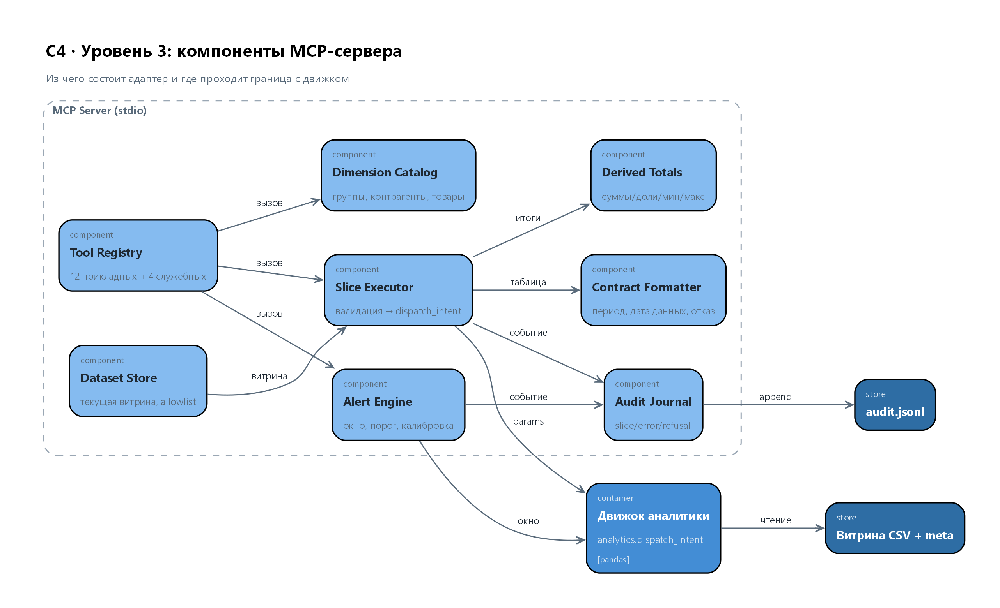

*Вектор: [architecture/04-mcp-components.svg](architecture/04-mcp-components.svg) · исходник: `architecture/src/04-mcp-components.dot`*


### 5.5 Прикладные сервисы (MCP tools: 12 инструментов)

| Группа | Инструменты | Назначение |
|---|---|---|
| Данные | `load_dataset`, `describe_dataset`, `describe_capabilities`, `list_dimensions` | состояние витрины, каталог, справка |
| Срезы | `total`, `top_bottom_products`, `compare_top_products`, `negative_revenue`, `timeseries`, `counterparty_dynamics`, `group_dynamics` | аналитика продаж |
| Оповещения | `returns_alert` | ежедневный алерт возвратов |

Итого **12 зарегистрированных инструментов**. Методы протокола MCP `list_resources`,
`read_resource`, `list_prompts`, `get_prompt` реализует SDK, но инструментами они не
являются: сервер не публикует ни ресурсов, ни промптов, поэтому `list_resources` и
`list_prompts` возвращают пустой список.

### 5.6 Контракт ответа (Application Interface)

```
Период: 01.01.2024–31.12.2024
Данные: выгрузка 12.11.2026 13:32        # или «время файла …»
Срез: top_bottom_products

| … таблица … |
Фильтр: группа «Аксессуары».             # если фильтр применён
Сумма по показанным строкам: … ₽; доля … %.
Показаны первые 50 из 120.               # если усечено
```

Правила: период и дата данных обязательны; при отсутствии периода — явная
пометка «взят весь период витрины»; отказ содержит причину и список доступных
срезов; параметры среза скрыты из чата (`ONEC_MCP_VERBOSE=1` — показать).

**Версия контракта.** Первой строкой каждого ответа (включая отказ) идёт
`Contract-Version: 1`; в пределах версии допускаются только обратносовместимые
изменения. Решение — [ADR 0011](adr/0011-answer-contract-version.md) (предложено;
реализация — следующий шаг).

### 5.7 Последовательности

**UC-1: ad-hoc вопрос**

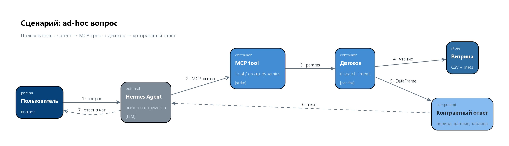

*Вектор: [architecture/05-adhoc-query-flow.svg](architecture/05-adhoc-query-flow.svg) · исходник: `architecture/src/05-adhoc-query-flow.dot`*


**UC-4: отказ**

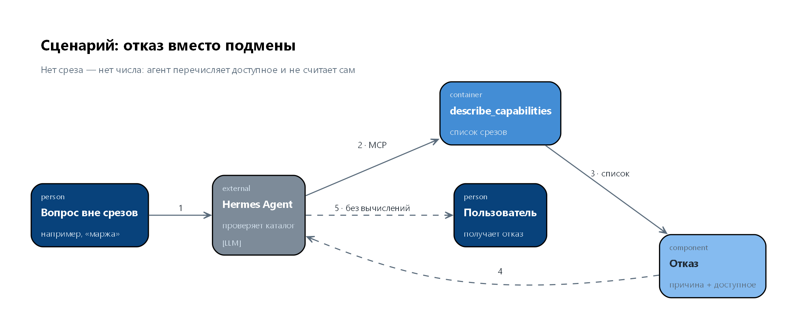

*Вектор: [architecture/06-refusal-flow.svg](architecture/06-refusal-flow.svg) · исходник: `architecture/src/06-refusal-flow.dot`*


**UC-2: проактивный алерт**

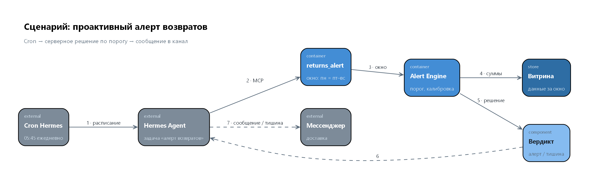

*Вектор: [architecture/07-returns-alert-flow.svg](architecture/07-returns-alert-flow.svg) · исходник: `architecture/src/07-returns-alert-flow.dot`*


**UC-3: смена витрины**

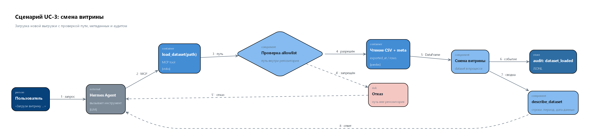

*Вектор: [architecture/13-dataset-switch-flow.svg](architecture/13-dataset-switch-flow.svg) · исходник: `architecture/src/13-dataset-switch-flow.dot`*


### 5.8 Состояние и согласованность

- Состояние v1 — текущая витрина в процессе сервера (одна на инстанс).
- Смена витрины — `load_dataset` с allowlist внутри репозитория.
- Мультипользовательская изоляция не заявлена; для неё потребуется
  dataset-id/сессия и отдельный ADR.
- Аудит и флаг алертов хранятся в `.mcp_state/` (вне git).

---

## 6. Архитектура данных (ArchiMate Data / TOGAF Phase C)

### 6.1 Логическая модель витрины

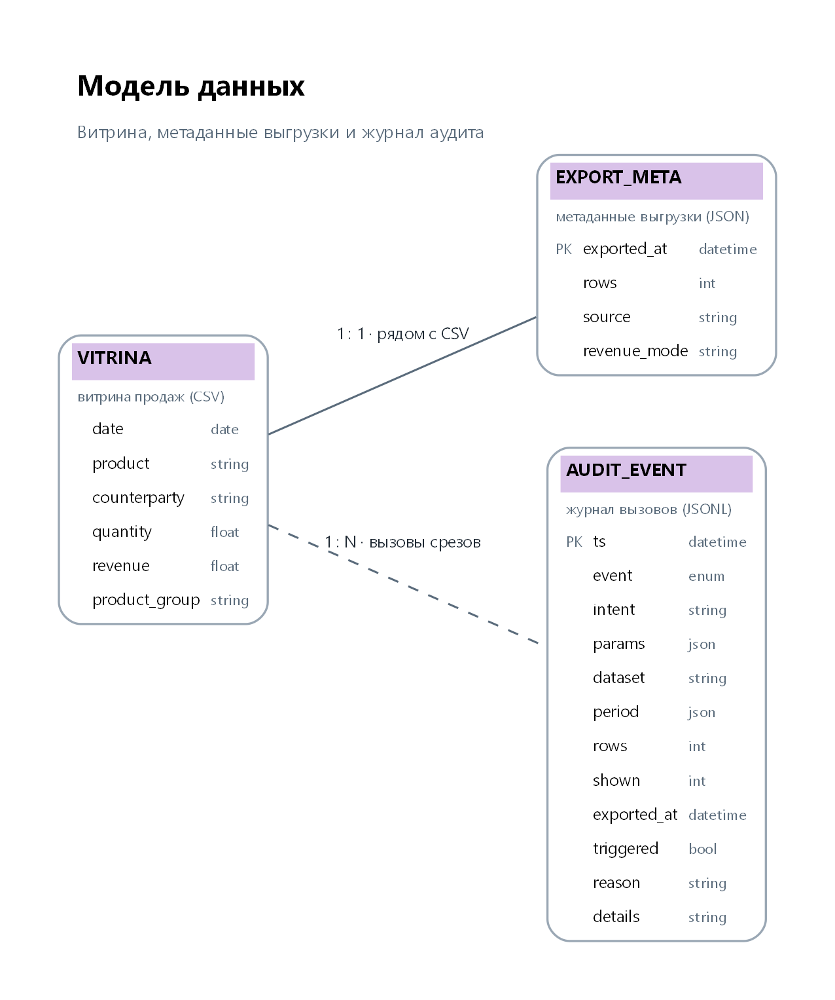

*Вектор: [architecture/08-data-model.svg](architecture/08-data-model.svg) · исходник: `architecture/src/08-data-model.dot`*


### 6.2 Правила данных

| Правило | Реализация |
|---|---|
| Выручка по умолчанию — net (без НДС) | `revenue_mode="net"` в загрузчике |
| Дата данных ≠ дата последней продажи | `exported_at` из `*.meta.json`; fallback — mtime файла |
| Строки без даты не относятся к периоду | фильтрация движком при заданных границах |
| Пустой результат — не ошибка | пустой DataFrame с тем же контрактом колонок |
| Аудит не содержит персональных данных | только срезы, параметры, датасет, вердикты |

### 6.3 Хранение и удержание

| Артефакт | Место | Политика |
|---|---|---|
| Витрина CSV | `sample_data.csv`, `1c_export/` (gitignore) | обновляется ETL; не публикуется |
| Метаданные выгрузки | `*.csv.meta.json` | рядом с CSV |
| Аудит | `.mcp_state/audit.jsonl` | локально, ротация/срок — по политике ИБ |
| Флаг алертов | `.mcp_state/alerts.disabled` | локально |
| Секреты | переменные окружения Hermes | не в репозитории |

---

## 7. Технологическая архитектура (ArchiMate Technology Layer)

### 7.1 Узлы и артефакты

| Узел | Артефакт | Назначение |
|---|---|---|
| Windows-хост (рабочее место) | `python.exe` venv 3.12+/3.14, `mcp` SDK | MCP-сервер, Streamlit UI, ETL, тесты |
| Windows-хост | Hermes Agent (gateway + Desktop) | клиент, канал, cron |
| Windows-хост | 1С:УТ + COM | источник, ETL |
| Файловая система | витрина, meta, аудит | данные |
| Сеть (опционально) | LLM-провайдер | диалог агента |

### 7.2 Deployment

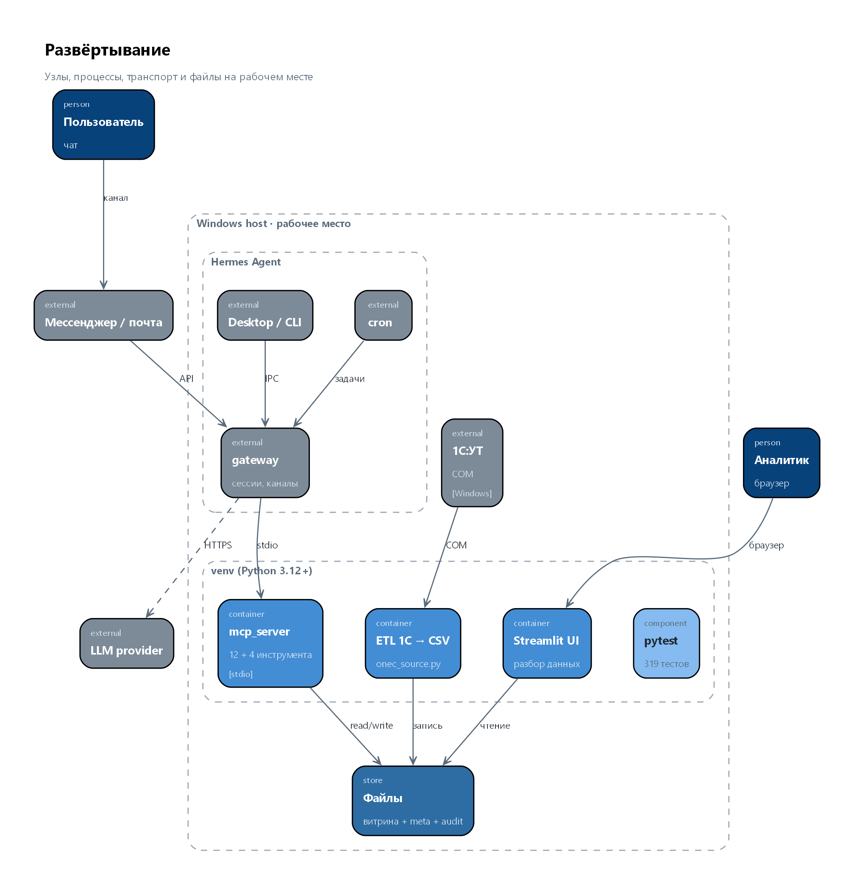

*Вектор: [architecture/09-deployment-view.svg](architecture/09-deployment-view.svg) · исходник: `architecture/src/09-deployment-view.dot`*


### 7.3 Протоколы и версии

| Интерфейс | Протокол | Версия/примечание |
|---|---|---|
| Hermes → MCP | MCP over stdio | сервер `mcp 1.30`, клиент Hermes `mcp 2.3`; протокол `2025-11-25` |
| MCP tools | JSON Schema аргументов | генерируется из сигнатур/моделей |
| ETL | файловый CSV + JSON meta | UTF-8 |
| UI | Python API | без сетевого контракта |

---

### 7.4 Конфигурационное представление (Hermes profile)

Поверхность инструментов и поведение агента задаются не только кодом, но и
профилем Hermes. Эти настройки — часть архитектуры решения:

| Ключ | Значение | Эффект |
|---|---|---|
| `mcp_servers.1c-analyst` | command / args / cwd / env / timeout | запуск stdio-процесса сервера |
| `platform_toolsets.local`, `.desktop` | `[mcp-1c-analyst, skills, todo]` | только MCP + навыки/задачи |
| `agent.disabled_toolsets` | terminal, file, web, search, browser, code_execution, vision, image_gen | нет доступа к ФС, сети и коду |
| `tools.tool_search` | `off` | инструменты не откладываются |
| `terminal.cwd` | корень репозитория | обнаружение `.hermes.md` |
| `.hermes.md` | правила проекта | числа только из MCP, без самосчёта |
| `ONEC_MCP_STATE_DIR` | `.mcp_state` | путь состояния |
| `ONEC_MCP_AUDIT_FILE` | `audit.jsonl` | журнал вызовов |
| `ONEC_ALERTS_ENABLED` | `0/1` | kill switch алертов |

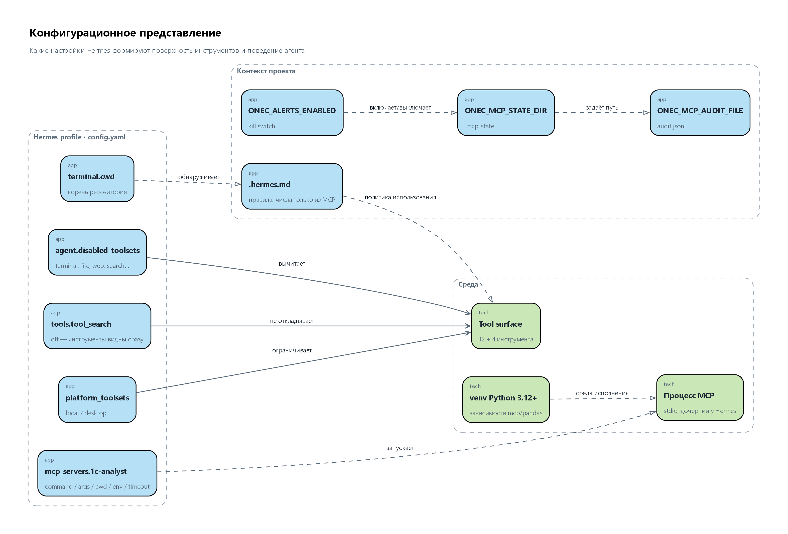

*Вектор: [architecture/12-configuration-view.svg](architecture/12-configuration-view.svg) · исходник: `architecture/src/12-configuration-view.dot`*

---

## 8. ArchiMate-отношения (трассировка слоёв)

| Отношение | Источник | Цель |
|---|---|---|
| Realization | MCP Server | Аналитика продаж (Business Service) |
| Serving | MCP tool `total` | Ответ на вопрос о продажах (Process) |
| Access | Slice Executor | Витрина (Data Object) |
| Realization | `analytics.dispatch_intent` | Прикладной сервис среза |
| Used by | Alert Engine | Контроль возвратов (Business Process) |
| Association | Audit Journal | Протокол сверки/аудит (Data Object) |
| Serving | Hermes Agent | UC-1…UC-5 |

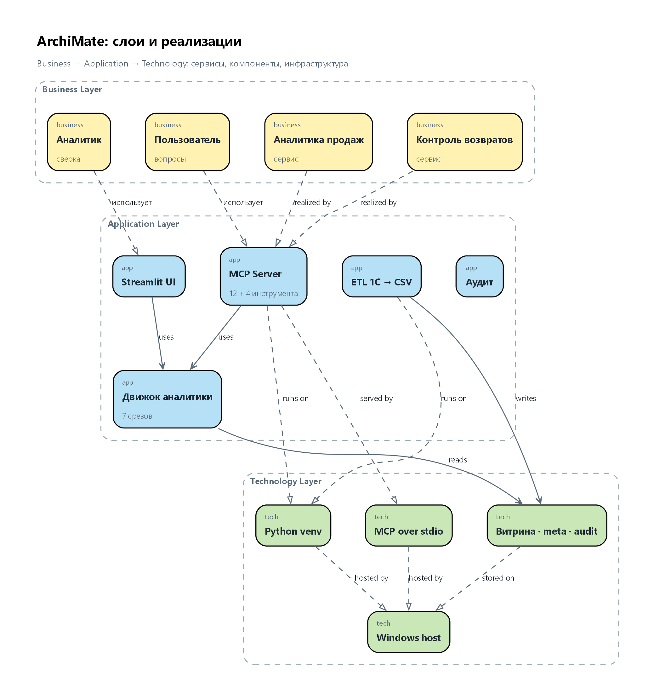

*Вектор: [architecture/11-archimate-layers.svg](architecture/11-archimate-layers.svg) · исходник: `architecture/src/11-archimate-layers.dot`*


---

## 9. Сквозные аспекты

### 9.1 Безопасность

| Угроза | Мера |
|---|---|
| Агент читает произвольные файлы | `agent.disabled_toolsets` (terminal/file/web/search/browser/code_execution/vision/image_gen), `tools.tool_search: off`, `.hermes.md` правила |
| Подмена ответа похожим срезом | типизированные инструменты, отказ, `describe_capabilities` |
| Утечка данных в модель | срезы возвращают агрегаты; названия юрлиц — коммерческая тайна (политика ИБ) |
| Запись/изменение 1С | сервер read-only, нет SQL, нет write-tools |
| Утечка путей | ответы содержат путь относительно репозитория |

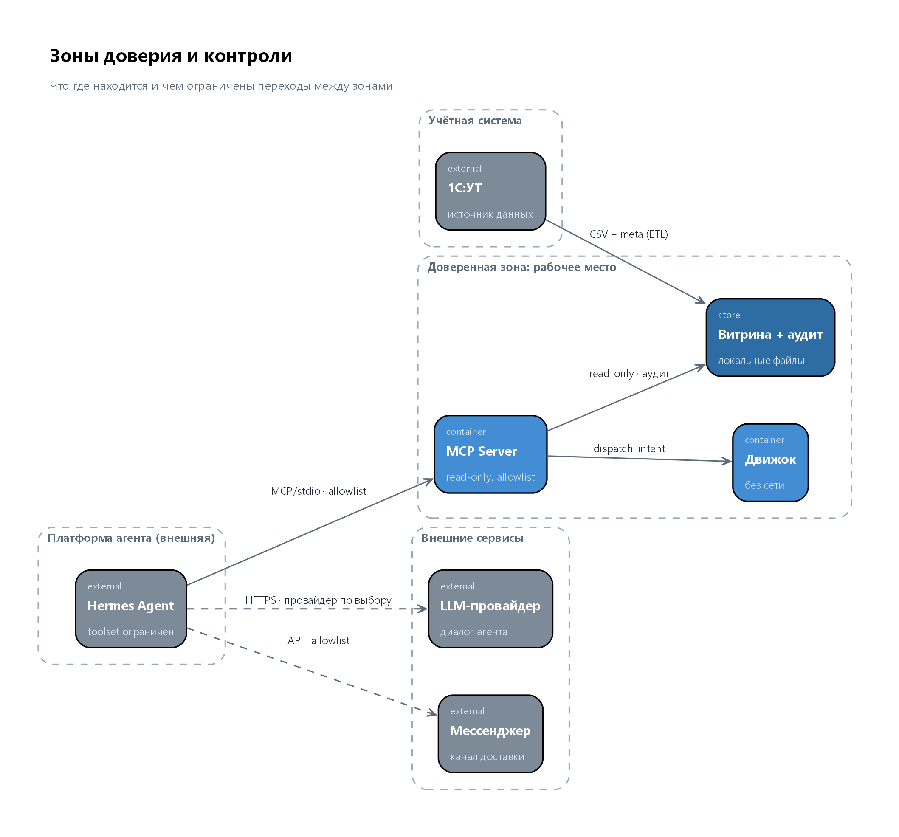

*Вектор: [architecture/10-trust-zones.svg](architecture/10-trust-zones.svg) · исходник: `architecture/src/10-trust-zones.dot`*

### 9.2 Наблюдаемость

- Аудит JSONL: `ts, event, intent, params, dataset, period, rows, exported_at`.
- События: `slice`, `error`, `refusal`, `dataset_loaded`, `alert`.
- Метрика отказов: `summarize_audit(days=30)` → `refusal_rate`, топ причин.
- Логи сервера — только stderr (stdout занят JSON-RPC).

### 9.3 Надёжность и деградация

| Отказ | Поведение |
|---|---|
| Нет витрины | отказ «витрина не загружена» |
| Битые метаданные | fallback на время файла с пометкой |
| Ошибка среза | контрактный ответ «Ошибка: …» + запись `error` |
| Сбой аудита | ответ не ломается, предупреждение в лог |
| Выключенные алерты | `returns_alert` сообщает об отключении |

### 9.4 Производительность и стоимость

- Вызов среза: ~0.02 с на витрине 3 859 строк (измерено).
- Нет второго LLM внутри сервера: планирует только агент.
- Стоимость вопроса = стоимость токенов агента; детерминированные срезы — 0 ₽.
- Ограничение вывода: 50 строк на таблицу с пометкой усечения.

**Метрики (целевые, для пилота):**

| Метрика | Как измерять | Цель |
|---|---|---|
| p50/p95 времени MCP-вызова | поле `duration_ms` в аудите (следующий шаг) | p95 < 300 мс |
| `refusal_rate` | `summarize_audit(days=30)` | рост — сигнал пробелов в срезах |
| число смен витрины | аудит `dataset_loaded` | контроль свежести данных |
| доля ошибок | аудит `error` / все вызовы | < 1 % |
| срабатывания алертов | аудит `alert` | по политике (baseline) |


### 9.5 Качество (ISO/IEC 25010)

| Характеристика | Как обеспечена |
|---|---|
| Functional suitability | 7 срезов + отказы; 319 тестов |
| Reliability | fallback-и, контракт ошибок, аудит |
| Performance | быстрые срезы, лимит вывода |
| Security | read-only, allowlist, отключение терминала |
| Maintainability | тонкий адаптер, контракт отдельным модулем, тесты |
| Portability | MCP-стандарт, stdio, Windows/Linux |

---

## 10. Трассировка требований

| Требование | Компонент | Проверка |
|---|---|---|
| R1 типизированные срезы | Tool Registry, Slice Executor | `tests/test_mcp_server.py` |
| R2 схема/каталог срезов | `describe_capabilities`, `list_dimensions` | тесты + приёмка |
| R3 смена витрины | Dataset Store | `dataset_loaded` в аудите |
| R4 период и дата данных | Contract Formatter | `tests/test_answer_contract.py` |
| R5 отказ вместо подмены | Contract Formatter, движок | приёмка, аудит |
| R6 алерты и расписание | Alert Engine, cron Hermes | `tests/test_alerts.py` |
| R7 аудит и права | Audit Journal, конфиг Hermes | аудит-журнал |
| R8 совместимость версий | stdio, `mcp` SDK | `tests/test_mcp_stdio.py` |

---

### 10.1 Тестовая архитектура

| Уровень | Что проверяет | Файлы | Кол-во |
|---|---|---|---|
| Модульный (движок, DSL) | срезы, периоды, фильтры, планировщик, уточнения, лимиты | `test_analytics`, `test_planner`, `test_clarification`, `test_rate_limiter` | 188 |
| Приложение/UI | отображение, вопросы, planner UI, статика | `test_app_display`, `test_app_question`, `test_app_planner`, `test_app_static` | 60 |
| Контракт ответа/MCP | период, дата данных, отказы, 12 инструментов | `test_answer_contract`, `test_mcp_server` | 29 |
| Аудит и stdio | записи журнала, handshake, `list_tools` | `test_mcp_audit`, `test_mcp_stdio` | 10 |
| Алерты | окна, пороги, kill switch, калибровка | `test_alerts` | 15 |
| Метаданные выгрузки | `exported_at`, fallback, Streamlit-safe | `test_export_meta` | 9 |
| Демо-транскрипт | контракт в сгенерированном диалоге | `test_demo_transcript` | 8 |
| **Итого** | | | **319** |

Приёмочные прогоны (20 демо + 10 реальных вопросов) выполняются вручную в
Hermes и фиксируются в локальном протоколе; в CI они не входят.

## 11. Риски архитектуры

| Риск | Влияние | Мера |
|---|---|---|
| Модель обходит правила | подмена | отключённые toolsets, инструкции, приёмка по аудиту |
| Desktop-сессии игнорируют `platform_toolsets` | полный набор инструментов | ключ `local` + `agent.disabled_toolsets` (проверено) |
| Эволюция Hermes/конфига | несовместимость | фиксированная версия, тонкий адаптер, MCP-стандарт |
| Одна витрина на процесс | смешение контекста | v1 — один владелец; ADR для мультиюзера |
| Рост токенов при большом tool-наборе | цена/латентность | `tool_search` off только для узкого набора + отключённые toolsets |

---

## 12. Решения и эволюция

| ADR | Решение | Статус |
|---|---|---|
| 0004 | JSON-DSL + Pydantic + `dispatch_intent` | принят |
| 0008 | Сравнение топов (L4L) | принят |
| [0009](adr/0009-mcp-facade.md) | MCP-фасад над JSON-DSL | принято |
| [0010](adr/0010-export-timestamp.md) | `exported_at` из метаданных выгрузки | принято |
| [0011](adr/0011-answer-contract-version.md) | Версия контракта ответа | предложено |
| [0012](adr/0012-gigachat-provider.md) | GigaChat как провайдер (tool calling) | предложено |

**Эволюция:** v1 — stdio, одна витрина, read-only; v2 — dataset-id/сессии,
изоляция пользователей, HTTP-транспорт, мультиюзер; v3 — Skills/каналы,
проактивные сценарии по расписанию.

---

## 13. Глоссарий

| Термин | Значение |
|---|---|
| Срез (intent) | типизированный аналитический запрос движка |
| DSL | JSON-контракт «intent + params» между LLM и кодом |
| Контракт ответа | обязательные поля периода/даты данных и правила отказа |
| Витрина | очищенный DataFrame продаж |
| Дата данных | `exported_at` выгрузки (не дата продажи) |
| MCP | Model Context Protocol, транспорт инструментов |
| Аудит | JSONL-журнал вызовов и отказов |

---

## Приложение A. Галерея схем

### Бизнес-слой (ArchiMate)


### Контекст (C4 L1)


### Контейнеры (C4 L2)


### Компоненты (C4 L3)


### Сценарий: ad-hoc вопрос


### Сценарий: отказ


### Сценарий: алерт возвратов


### Модель данных


### Развёртывание


### Зоны доверия


### ArchiMate: слои


### Конфигурационное представление


### Сценарий UC-3: смена витрины


Все схемы — векторные (`architecture/*.svg`) и растровые (`architecture/*.png`, 200 dpi).
Исходники — `architecture/src/*.dot`; сборка — `python docs/architecture/build_diagrams.py`.
