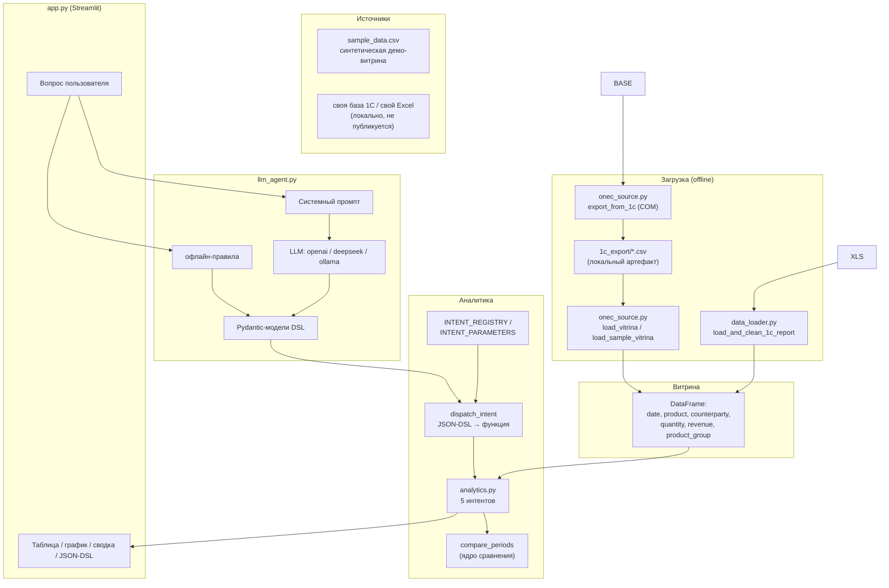

# Архитектура

Документ описывает устройство проекта на уровне компонентов, потоков данных и контрактов. Методические компромиссы зафиксированы в [ADR](adr/), отчёт о результатах — в [REPORT.md](REPORT.md).

## 1. Цели и не-цели

**Цели**

- Превратить вопрос на естественном языке в ответ по данным 1С без вычислений в LLM.
- Единая витрина данных из двух источников: Excel-выгрузка «Универсального отчёта» и прямая выгрузка из регистра 1С.
- Пять аналитических интентов MVP, готовых к отрисовке (таблица/график) и текстовому объяснению.
- Контракт для LLM: строгий JSON-DSL, реестр интентов, валидация параметров.
- Воспроизводимость: контрольные суммы, предупреждения о качестве, сквозной smoke-тест.

**Не-цели (сознательно вне текущего этапа)**

- LLM-агент/промпт-инжиниринг и UI — следующий шаг.
- Прямое подключение к 1С из рабочего Python-процесса (сейчас — двухшаговый экспорт, см. [ADR 0005](adr/0005-onec-export-split.md)).
- Поддержка серверных баз 1С, кластеров и прав доступа — MVP рассчитан на файловую базу.
- Продакшен-SLA.

## 2. Компоненты



| Модуль | Ответственность | Ключевые точки входа |
|---|---|---|
| `data_loader.py` | ETL Excel: шапка, «Итого», склейки, даты, типы, валидация, предупреждения | `load_and_clean_1c_report` |
| `analytics.py` | Интенты, сравнение периодов, группы, диагностика, DSL | `get_*`, `compare_periods`, `dispatch_intent` |
| `onec_source.py` | COM-подключение, выгрузка регистра/справочника, CSV, загрузка витрины | `export_from_1c`, `load_vitrina` |
| `llm_agent.py` | Pydantic-модели DSL, промпт, LLM-клиент, офлайн-правила, разбор/«починка» JSON | `parse_plan_json`, `make_planner`, `check_schema_sync` |
| `app.py` | Streamlit UI: источник, качество данных, вопрос, результат, JSON-DSL | `main` |
| `smoke_test.py` | Сквозная проверка данных и интентов | CLI |
| `smoke_llm.py` | Самопроверка LLM-слоя на Pydantic | CLI |

## 3. Потоки данных

### 3.1. Путь Excel

1. `pandas.read_excel(sheet_name=0, skiprows=7)` → строка 8 становится заголовком.
2. Удаление строк «Итого»/пустых; проверка структуры по контрольным заголовкам (позиции колонок фиксированы).
3. Разбор склеек: `A` → товар до `;`, `V` → контрагент до `;`, `E` → дата регуляркой.
4. Числа → `float64`, `NaN → 0`; отрицательные сохраняются.
5. Сортировка `date, product, counterparty` (`NaT` в конце), `RangeIndex`.
6. Предупреждение о качестве: строки/выручка без даты, отрицательные строки, удалённые строки.

### 3.2. Путь 1С

1. `export_from_1c` → COM (`V83.COMConnector`) → запрос к `РегистрНакопления.ВыручкаИСебестоимостьПродаж`.
2. Отдельный запрос справочника «Номенклатура» и построение групп (ближайший родитель + полный путь).
3. Запись `sales_1c.csv` (11 колонок, см. [DATA_CONTRACT.md](DATA_CONTRACT.md)) и `nomenclature_1c.csv` — только локально, каталог `1c_export/` в `.gitignore`.
4. `load_vitrina` (pandas) → витрина + `product_group`; режим выручки `net`/`gross`.
5. Для демо-запуска без 1С используется `load_sample_vitrina("sample_data.csv")` — синтетическая витрина с той же схемой.

### 3.3. Аналитика

- `filter_by_period` — единая политика периодов: при заданных границах строки без даты исключаются и об этом выпускается предупреждение.
- Интенты собирают таблицу, готовую к `st.dataframe`/`st.plotly_chart`.
- `compare_periods` — общее ядро интентов 2 и 4: `period1_value`, `period2_value`, `delta`, `delta_pct`, `direction`.
- `dispatch_intent` валидирует JSON-DSL (имя интента, лишние/недостающие параметры) и вызывает функцию.

### 3.4. LLM-путь

1. `app.py` собирает вопрос, историю диалога и профиль данных (строки, диапазон дат, товары/контрагенты).
2. `llm_agent.build_messages` → системный промпт + история + вопрос → OpenAI-совместимый клиент (`openai`/`deepseek`/`ollama`).
3. Ответ модели извлекается из текста (в т.ч. из ```json), валидируется Pydantic-моделями (discriminated union по `intent`, `extra="forbid"`); при ошибке — одна «починка» JSON.
4. `to_dispatch_params` → `analytics.dispatch_intent` → DataFrame.
5. Без провайдера (`LLM_PROVIDER=none`) используется `RuleBasedPlanner`; неоднозначный вопрос возвращает `clarification`, UI показывает уточнение.
6. `check_schema_sync()` при старте приложения сверяет модели с `analytics.INTENT_PARAMETERS`; `docs/intent_schema.json` — та же схема для интеграций.

### 3.5. Graceful degradation ([ADR 0007](adr/0007-graceful-degradation.md))

Вопросы бывают неоднозначными и составными, а DSL — один интент на запрос. Поэтому сбой понимания не приводит к падению или бесконечному уточнению:

1. **Уточнение:** `clarification.choose_clarified_text` решает, показывать в поле только вторую часть (полный вопрос) или склейку с исходным вопросом (фрагмент); спорный случай — LLM-классификатор, при ошибке — безопасная склейка.
2. **Лимит:** `MAX_CLARIFICATIONS = 2`; после второго уточнения `clarification.force_interpretation` разбирает вопрос **детерминированными правилами** (без LLM) и показывает результат с плашкой «Уточнения исчерпаны — показываю как понял…».
3. **Отказ:** если правила тоже не выбрали интент — понятное сообщение и список доступных вопросов; трейсбека нет.

Составной запрос («топ за 2023 и отдельно за 2024») в MVP **не разбивается на два рейтинга**: fallback сводит его к одному показателю за общий диапазон, о чём честно сообщает. Числа во всех уровнях считает только pandas.

## 4. Хранение

| Объект | Где | В git |
|---|---|---|
| Синтетическая демо-витрина | `sample_data.csv` | да |
| Реальная выгрузка 1С | `1c_export/*.csv` | нет (`.gitignore`) |
| Excel-выгрузка | `тест.xlsx` | нет (`.gitignore`) |
| Код | `*.py` в корне | да |
| Документация | `docs/`, `progress.md`, `CHANGELOG.md` | да |
| Временные профили/сессии | не хранятся | нет |

## 5. Окружение

| Компонент | Версия/факт |
|---|---|
| Python проекта | 3.12.14 (DSH runtime), pandas 3.0.1, numpy 2.3.5, openpyxl 3.1.5 |
| Python для выгрузки 1С | 3.14, `pywin32` 312 (pandas отсутствует) |
| 1С:Предприятие | 8.3.27.1688 |
| Конфигурация | «Управление торговлей, редакция 11», 11.5.22.77 |
| База | `<путь к базе 1С>` (файловая, `1Cv8.1CD` 2,77 ГБ) |
| Лицензия | `C:\ProgramData\1C\licenses\*.lic` |

## 6. Решения (ADR)

| ADR | Решение |
|---|---|
| [0001](adr/0001-revenue-net.md) | Выручка по умолчанию — без НДС; с НДС — отдельным режимом |
| [0002](adr/0002-onec-direct-source.md) | Для периодической аналитики предпочтителен источник 1С, Excel — fallback |
| [0003](adr/0003-product-groups.md) | Товарные группы — иерархия номенклатуры (ближайшая группа + путь), эвристика — fallback |
| [0004](adr/0004-llm-json-dsl.md) | Граница LLM → код — JSON-DSL, реестр интентов и `dispatch_intent` без жёсткой зависимости от Pydantic |
| [0005](adr/0005-onec-export-split.md) | Выгрузка 1С и анализ разделены на два шага; CSV — контракт |
| [0006](adr/0006-llm-providers.md) | LLM-провайдеры через OpenAI-совместимый протокол; офлайн-правила как фолбэк |
| [0007](adr/0007-graceful-degradation.md) | Graceful degradation: умный текст уточнения, лимит 2 уточнения, детерминированный fallback, честная плашка |

## 7. Ограничения и точки роста

1. **Даты:** в Excel-выгрузке периода нет; источник 1С обязателен для полной динамики.
2. **Имена товаров:** Excel-представления обрезаны; канонические имена — из справочника 1С.
3. **`pywin32`:** не входит в рабочий Python; либо установить (`pip install pywin32`), либо использовать раздельные интерпретаторы (текущая схема).
4. **Права на файловую базу:** 1С нужны lock-файлы; в ограниченной песочнице используется копия базы.
5. **Товарные группы:** в выгрузке Excel их нет; для Excel-режима остаётся эвристика.
6. **Единая схема:** при появлении новых источников (ERP, КА) расширять `COL_*` и `OUTPUT_COLUMNS`, не размазывая позиции по коду.
7. **Составные запросы:** один DSL-интент на запрос; «два рейтинга за два периода» не поддерживаются — fallback сводит к одному диапазону ([ADR 0007](adr/0007-graceful-degradation.md)).

**Точки расширения**

- Новый интент → функция + запись в `INTENT_REGISTRY`/`INTENT_PARAMETERS` + Pydantic-модель в `llm_agent.py`.
- Другой LLM-провайдер → переменные окружения (`LLM_PROVIDER`/`LLM_BASE_URL`), без правки кода.
- Другая метрика → расширить `METRICS` и обработку в агрегациях.
- Новый источник → функция `load_*`, возвращающая витрину с тем же контрактом.
- UI → `app.py`; LLM-инструмент для LangChain → обёртка над `dispatch_intent`/`parse_plan_json`.
