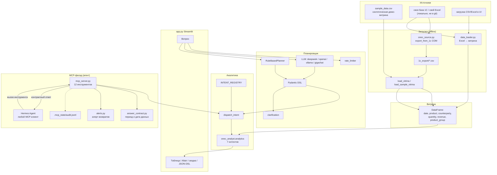

# Архитектура

> **Уровень документа.** Это архитектура приложения (UI, движок, данные).
> Архитектура решения в целом — MCP-фасад, интеграции, C4/ArchiMate-схемы —
> в [ARCHITECTURE-SOLUTION.md](ARCHITECTURE-SOLUTION.md).

Актуальное устройство продукта **1c-ai-analyst 0.8.0**: компоненты, потоки данных, контракты и ограничения. Методические решения — в [ADR](adr/).

## 1. Цели и не-цели

**Цели**

- Ответ на вопрос на естественном языке по витрине продаж 1С **без вычислений в LLM** (NL2DSL, не NL2SQL).
- Единая витрина: синтетическое демо, CSV-снимок из 1С, пользовательский CSV/Excel.
- Семь аналитических интентов с таблицей, графиком Altair и текстовой сводкой.
- Контракт LLM: JSON-DSL → Pydantic (`extra="forbid"`) → `dispatch_intent` → pandas.
- Воспроизводимость: синтетические контрольные суммы, smoke-тесты, pytest/CI.

**Не-цели (сознательно вне scope)**

- Прямое live-подключение UI к базе 1С (см. [ADR 0005](adr/0005-onec-export-split.md)).
- Серверные кластеры 1С, ролевая модель прав, продакшен-SLA.
- Multi-intent в одном ответе (кроме L4L-сравнения топов, [ADR 0008](adr/0008-compare-tops-intent.md)).
- Расчёт «среднего чека» и произвольного SQL от модели.

## 2. Компоненты

| Модуль | Ответственность | Точки входа |
|---|---|---|
| `onec_analyst.data_loader` | ETL Excel «Универсального отчёта» | `load_and_clean_1c_report` |
| `onec_analyst.onec_source` | COM-выгрузка 1С → CSV; загрузка витрины | `export_from_1c`, `load_vitrina`, `load_sample_vitrina` |
| `onec_analyst.analytics` | 7 интентов, периоды, фильтры, DSL | `dispatch_intent`, `INTENT_REGISTRY` |
| `onec_analyst.llm_agent` | Pydantic-модели, промпт, офлайн-правила, `guard_decision`; HTTP-клиент OpenAI-совместимых провайдеров (нативные tools + JSON-fallback) и legacy-клиент GigaChat (health-check/список моделей) | `make_planner`, `parse_plan_json`, `make_client` |
| `onec_analyst.agent.llm` | Провайдерный слой LangGraph-агента: GigaChat через официальную `langchain-gigachat`, адаптер к интерфейсу `complete`/`chat`; модель — только `model=settings.model`, без хардкода и автоподбора ([ADR 0014](adr/0014-gigachat-langchain.md)) | `make_agent_client`, `LangChainGigaChatClient` |
| `onec_analyst.agent.audit` | Аудит шагов графа: `graph_start/end`, `agent_decision`, `validate_ok/fail`, `fix_dsl`, `clarify`, `refuse`, `handle_error`; без вопроса и секретов ([ADR 0015](adr/0015-native-tools-audit.md)) | `audit_event` |
| `onec_analyst.clarification` | Текст после уточнения; принудительная интерпретация | `choose_clarified_text`, `force_interpretation` |
| `onec_analyst.dispatcher` | Единая точка обработки вопроса: план → защита → расчёт → сводка; без импорта Streamlit ([ADR 0013](adr/0013-langgraph-hybrid-contract.md)) | `process_request`, `AssistantResult` |
| `onec_analyst.session_log` | Журнал аналитических сессий в `db/sessions.db`: одна строка на запрос, fail-safe запись, пометки выгрузки ([ADR 0016](adr/0016-session-journal-notion-export.md)) | `record_request`, `pending_records`, `mark_exported` |
| `onec_analyst.notion_export` | Выгрузка журнала во внешнюю витрину и беклог задач — **вне пути обработки запроса** ([ADR 0016](adr/0016-session-journal-notion-export.md)) | `export_chat`, `export_pending`, `add_backlog_item` |
| `onec_analyst.analytics_db` | Архив выгрузки 1С в `db/analytics.db`: `nomenclature`, `sales`, `meta` ([ADR 0017](adr/0017-1c-export-sqlite.md)) | `refresh`, `stats` |
| `onec_analyst.testing_db` | Тестовые артефакты в той же БД: программа, результаты, golden-кассеты ([ADR 0018](adr/0018-testing-artifacts-sqlite.md)) | `import_testing`, `stats` |
| `onec_analyst.rate_limiter` | Лимиты вызовов LLM для демо (SQLite) | `check_limit`, `increment` |
| `onec_analyst.mcp_server` | MCP-фасад: 12 инструментов, состояние витрины, аудит вызовов | `mcp` (stdio) |
| `onec_analyst.answer_contract` | Шапка ответа MCP: период, дата данных, отказ, усечение | `format_answer`, `format_refusal` |
| `onec_analyst.audit` | JSONL-журнал вызовов и отказов, сводка за окно | `AuditLog`, `summarize_audit` |
| `onec_analyst.alerts` | Алерт возвратов: окно «пн = пт–вс», порог, калибровка, kill switch | `returns_alert` |
| `app.py` | Streamlit UI (корень репозитория) | `main` |
| `scripts/load_1c_to_sqlite.py`, `scripts/load_testing_to_sqlite.py` | CLI-загрузка архива 1С и тестовых артефактов в `db/analytics.db` | CLI |
| `scripts/notion_export.py` | CLI-обёртка выгрузки журнала и беклога; в пути запроса не участвует | CLI |
| `smoke_test.py` / `smoke_llm.py` | Сквозные проверки данных и LLM-слоя | CLI |

**Семь интентов:** `top_bottom_products`, `compare_top_products`, `negative_revenue`, `timeseries`, `counterparty_dynamics`, `group_dynamics`, `total`.

## 3. Потоки данных

### 3.1. Excel

`data_loader`: шапка отчёта, удаление «Итого», разбор склеек товар/контрагент, дата из текста документа, типы, предупреждения о качестве. Позиции колонок — константы `COL_*`.

### 3.2. 1С (Data Snapshot)

1. `export_from_1c` → COM → регистр «Выручка и себестоимость продаж» + справочник «Номенклатура».
2. Локальные CSV в `1c_export/` (в `.gitignore`).
3. `load_vitrina` → единая схема витрины; выручка по умолчанию **без НДС** ([ADR 0001](adr/0001-revenue-net.md)).
4. Демо без 1С: `sample_data.csv` через `load_sample_vitrina`.

### 3.3. Аналитика

- `filter_by_period` — единая политика периодов (строки без даты при заданных границах исключаются).
- Фильтры: `product_filter`, `group_filter`, `min_base_revenue`, `only_drops`.
- `dispatch_intent` валидирует имя интента и параметры по `INTENT_PARAMETERS`.

### 3.4. LLM-путь

1. UI собирает вопрос, историю и профиль данных.
2. При включённой LLM — проверка `rate_limiter`; при исчерпании — офлайн-правила.
3. Ответ модели → нативный tool call (OpenAI/DeepSeek/Ollama/GigaChat) или JSON-адаптер; при ошибке — одна «починка».
4. `guard_decision` не даёт подменить запрос про возвраты антитопом.
5. `to_dispatch_params` → `dispatch_intent` → DataFrame → таблица / Altair / сводка.
6. `check_schema_sync()` сверяет Pydantic с `INTENT_PARAMETERS`; схема также в `docs/intent_schema.json`.
7. Каждый шаг агентного графа пишется в `.mcp_state/audit.jsonl` (ADR 0015); сырой вопрос и секреты не логируются.

Офлайн-правила (`RuleBasedPlanner`) — **safety net**, а не второй DSL-движок: эвристики и регулярки разбирают типовые формулировки без API; числа по-прежнему считает только `analytics.dispatch_intent` / pandas. Источник истины схемы интентов — `INTENT_REGISTRY` / Pydantic, не набор правил.

### 3.5. Graceful degradation ([ADR 0007](adr/0007-graceful-degradation.md))

1. Уточнение через Quick Replies; `clarification` выбирает полный вопрос или склейку.
2. После 2 уточнений — детерминированный fallback без LLM.
3. Если разобрать нельзя — понятный отказ, без трейсбека.

Сравнение двух топов — отдельный интент L4L ([ADR 0008](adr/0008-compare-tops-intent.md)).

### 3.6. MCP-путь (агент)

1. MCP-клиент (Hermes Agent) вызывает типизированный инструмент — `total`, `top_bottom_products`, `timeseries` и т.д.
2. `mcp_server` валидирует параметры теми же моделями, что движок, и вызывает `dispatch_intent`.
3. Ответ собирает `answer_contract`: период, дата данных из `*.csv.meta.json`, серверные итоги; нет среза — отказ.
4. Каждый вызов пишется в `.mcp_state/audit.jsonl` (`slice` / `error` / `refusal` / `dataset_loaded` / `alert`).

### 3.7. Журнал сессий и внешняя витрина ([ADR 0016](adr/0016-session-journal-notion-export.md))

1. Каждый запрос из UI пишет одну строку в `db/sessions.db`: вопрос, провайдер, модель, DSL, статус, вердикт, длительность, токены, деградация; история диалога — `chat_id`/`turn`/`answer`.
2. Запись **fail-safe**: ошибка журнала не прерывает ответ. Сырой ответ модели хранится только по флагу `ONEC_SESSION_LOG_RAW`.
3. Выгрузка — отдельное действие пользователя (кнопка **«Выгрузить»** или `scripts/notion_export.py`), в пути обработки запроса внешних вызовов нет. Повторная выгрузка не создаёт дублей (`exported_at IS NULL`).
4. Санитизация: текст вопроса → `<PROMPT>`, ПДн-подобные строки → `<PII>`, локальные пути не отправляются.

### 3.8. Архив 1С и тестовых артефактов в SQLite ([ADR 0017](adr/0017-1c-export-sqlite.md), [ADR 0018](adr/0018-testing-artifacts-sqlite.md))

1. `scripts/load_1c_to_sqlite.py` читает CSV-выгрузку (`1c_export/`) и полностью перезаписывает `nomenclature`/`sales` в `db/analytics.db` одной транзакцией; в `meta` — источник, sha256, время и найденные аномалии.
2. `scripts/load_testing_to_sqlite.py` импортирует программу тестирования, результаты по моделям и golden-кассеты; перезагрузка 1С тестовые таблицы не стирает.
3. Данные кладутся «как есть»: будущие даты, нулевые и отрицательные выручки не фильтруются, а фиксируются в `meta.anomalies`.

## 4. Хранение

| Объект | Где | В git |
|---|---|---|
| Синтетическая демо-витрина | `sample_data.csv` | да |
| Реальная выгрузка 1С | `1c_export/*.csv` | нет |
| Excel-выгрузка | локально | нет |
| Код и публичная документация | корень, `docs/` | да |
| Внутренний журнал разработки | `progress.md` (локально) | нет |
| Лимиты LLM | `rate_limit.db` | нет |
| Журнал аналитических сессий | `db/sessions.db` | нет |
| Архив 1С и тестовых артефактов | `db/analytics.db` | нет |
| Локальные копии выгрузки во внешнюю витрину | `exports/` | нет |
| Аудит MCP-вызовов | `.mcp_state/audit.jsonl` | нет |
| Состояние алертов | `.mcp_state/` | нет |

## 5. Окружение

| Компонент | Факт |
|---|---|
| Python (приложение / CI) | `requires-python` ≥ 3.12; CI гоняет 3.12, локальный `.venv` — 3.14.6 (тесты зелёные на обеих); зависимости — `requirements.txt` / `pyproject.toml` |
| UI / аналитика | Streamlit, Altair, pandas, numpy, Pydantic v2 |
| Выгрузка 1С | Windows, `pywin32`, платформа 8.3.23+, COM `V83.COMConnector` |
| Конфигурация (проверено) | УТ 11.5 (файловая база; путь и учётные данные не публикуются) |
| Контейнер | `Dockerfile` + `docker-compose.yml`, образ без 1С и без реальных выгрузок |

## 6. Решения (ADR)

| ADR | Решение |
|---|---|
| [0001](adr/0001-revenue-net.md) | Выручка по умолчанию без НДС |
| [0002](adr/0002-onec-direct-source.md) | Для периодики предпочтителен источник 1С |
| [0003](adr/0003-product-groups.md) | Группы = иерархия номенклатуры |
| [0004](adr/0004-llm-json-dsl.md) | Граница LLM → код: JSON-DSL + `dispatch_intent` |
| [0005](adr/0005-onec-export-split.md) | ETL и UI разделены; CSV — контракт |
| [0006](adr/0006-llm-providers.md) | OpenAI-совместимые провайдеры + офлайн-правила |
| [0007](adr/0007-graceful-degradation.md) | Лимит уточнений и детерминированный fallback |
| [0008](adr/0008-compare-tops-intent.md) | Сравнение топов (L4L) одним интентом |
| [0009](adr/0009-mcp-facade.md) | MCP-фасад над JSON-DSL |
| [0010](adr/0010-export-timestamp.md) | Дата данных из метаданных выгрузки |
| [0011](adr/0011-answer-contract-version.md) | Версия контракта ответа (предложено) |
| [0012](adr/0012-gigachat-provider.md) | GigaChat как провайдер (tool calling) |
| [0013](adr/0013-langgraph-hybrid-contract.md) | Гибридный LangGraph-агент и канонический DSL |
| [0014](adr/0014-gigachat-langchain.md) | GigaChat через `langchain-gigachat` |
| [0015](adr/0015-native-tools-audit.md) | Нативные tools и аудит шагов графа |
| [0016](adr/0016-session-journal-notion-export.md) | Журнал сессий в SQLite и выгрузка в Notion |
| [0017](adr/0017-1c-export-sqlite.md) | Выгрузка 1С в отдельную SQLite-БД: архив и SQL-слой |
| [0018](adr/0018-testing-artifacts-sqlite.md) | Тестовые артефакты в `db/analytics.db` |

## 7. Ограничения MVP и точки роста

1. **`RuleBasedPlanner`** разрастается вместе с формулировками пользователей; это допустимо только как offline safety net (§3.4), не как параллельная модель расчётов.
2. **Rate limiting:** лимит на сессию завязан на `session_id` в `st.session_state` (новый браузер/вкладка = новая сессия). Жёсткий потолок — глобальный дневной лимит. Ручной сброс сессии по умолчанию выключен (`RATE_LIMIT_ALLOW_RESET`).
3. Excel-выгрузка слабее снимка 1С по датам и группам.
4. Составные запросы кроме L4L-топов не разбиваются на несколько интентов.

**Расширение**

- Новый интент → функция + `INTENT_REGISTRY`/`INTENT_PARAMETERS` + Pydantic + промпт/правила + тест.
- Новый провайдер LLM → запись в реестре провайдеров (`_DEFAULT_MODELS`/`_DEFAULT_BASE_URLS`/`CHOOSABLE_PROVIDERS`) + переменные `LLM_*_<PROVIDER>`; добавление в UI-список моделей — только если у провайдера свой набор (как у GigaChat).
- Новый источник → `load_*` с тем же контрактом витрины.
- LangChain StructuredTool → тонкая обёртка над `parse_plan_json` / `dispatch_intent`.
