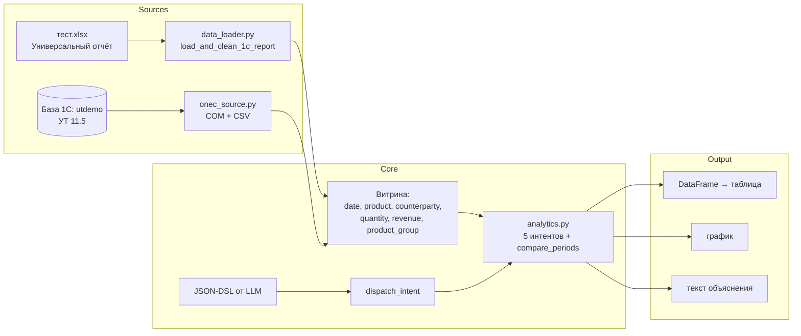

# Отчёт о разработке MVP «ИИ-ассистент для анализа данных из 1С»

> **Обновление 2026-10-24 (лицензионная чистка).** Реальные выгрузки 1С
> (`тест.xlsx`, `1c_export/`) удалены из репозитория и всей истории Git: данные
> являются частью программного продукта 1С и не подлежат распространению.
> Цифры и таблицы ниже относятся к исторической выгрузке и **не воспроизводятся**
> на синтетическом `sample_data.csv`; актуальный демо-набор описан в README.

- **Документ:** итоговый отчёт по шагу 1 и источнику данных 1С
- **Проект:** `1c-ai-analyst`
- **Дата:** 2026-10-23
- **Статус:** шаг 1 завершён; данные доступны из двух источников (Excel и 1С); шаг 2 (Streamlit UI + Pydantic + LLM-слой) — код готов, UI требует локального запуска
- **Связанные документы:** [ARCHITECTURE.md](ARCHITECTURE.md), [DATA_CONTRACT.md](DATA_CONTRACT.md), [RUNBOOK.md](RUNBOOK.md), [ITS_ACCESS_NOTES.md](ITS_ACCESS_NOTES.md), [ADR](adr/)

---

## 1. Резюме для руководителя

Сделан рабочий каркас аналитического MVP, в котором **LLM не считает числа**: языковая модель переводит вопрос на естественном языке в строгий JSON-DSL, а все расчёты выполняет pandas. Реализованы загрузчик выгрузки 1С, 5 аналитических интентов, слой диспетчеризации DSL → функция и тестовый прогон на реальном файле.

Ключевой результат: **данные из выгрузки и данные из самой базы 1С сходятся до копейки** (выручка без НДС 19 313 936,63 ₽, с НДС 22 957 182,97 ₽, количество 10 878). Дополнительно подключена база `<путь к базе 1С>` (УТ 11.5.22.77): выгрузка напрямую из регистра «Выручка и себестоимость продаж» закрывает две проблемы Excel-файла — у 250 строк (24,4 % выручки) не было даты, и не было товарных групп. После перехода на 1С-источник **дата есть у 100 % строк**, а товарные группы берутся из иерархии справочника «Номенклатура» (16 групп в периоде).

| Показатель | Excel-выгрузка | Источник 1С |
|---|---|---|
| Строк | 821 (сгруппировано отчётом) | 2 568 (записи регистра) |
| Строк без даты | 250 (24,4 % выручки) | **0** |
| Выручка без НДС | 19 313 936,63 | **19 313 936,63** |
| Товарных групп | нет (эвристика, 52 «группы») | **27 групп у товаров (61 в иерархии), 16 в периоде** |

---

## 2. Постановка задачи

**Цель MVP:** инструмент, который отвечает на вопросы пользователя к выгрузке из 1С на естественном языке и показывает результат таблицей, графиком и текстовым объяснением.

**Архитектурный принцип:** LLM не вычисляет числа. Её роль — только перевод вопроса в JSON:

```json
{"intent": "counterparty_dynamics",
 "params": {"period1": ["2023-01-01", "2023-12-31"],
            "period2": ["2024-01-01", "2024-12-31"],
            "metric": "revenue", "top_n": 10}}
```

**Пять интентов MVP:**

1. Топ/антитоп товаров («что продаётся лучше/хуже»).
2. Динамика контрагентов между двумя периодами (дельта в рублях и %).
3. Временной ряд продаж (месяц/квартал/год).
4. Срез по товарным группам между периодами («что просело»).
5. Общая сумма за период.

**Ограничения из ТЗ:** только pandas/numpy; без магических строк (имена колонок — константы); типизация и docstring'и; готовность к Streamlit и LangChain/Pydantic.

---

## 3. Исходные данные и их особенности

### 3.1. Файл `тест.xlsx`

Выгрузка «Универсального отчёта» по регистру накопления «Выручка и себестоимость продаж»: лист `Лист_1`, 830 строк × 57 колонок, первые 7 строк — шапка (параметры отчёта), 8-я — заголовки, последняя — «Итого».

### 3.2. Расхождения спецификации ТЗ с фактическим файлом

| Что сказано в ТЗ | Что в файле | Решение |
|---|---|---|
| `A` (0) — товар + склад через `;` | Совпадает | Берём до первого `;` |
| `E` (4) — документ с датой | Колонка называется «Заказ клиента», дата внутри текста документа | Регулярка `\d{2}\.\d{2}\.\d{4}` |
| `U` (20) — контрагент | **Колонка пуста** (это «Направление деятельности номенклатуры») | Контрагент в **`V` (21)** |
| `V` (21) — количество | Здесь контрагент | Количество в **`W` (22)** |
| `X` (23) — выручка **без** НДС | `X` = «Сумма выручки **с** НДС», `Y` (24) = «без НДС» | Режим `revenue_mode="net"` → `Y` (семантика ТЗ), `gross` → `X` |

Все позиции вынесены в константы `COL_*` в [data_loader.py](../data_loader.py); заголовки используются только для валидации структуры.

### 3.3. Качество данных Excel-выгрузки

| Показатель | Значение |
|---|---|
| Строк данных | 821 |
| Товаров / контрагентов | 96 / 40 |
| Строк без даты | 250 (30,5 %), в них выручки 4 720 144,90 (24,4 %) |
| Строк с нулевой выручкой | 108 (движения без выручки) |
| Строк с отрицательной выручкой (возвраты/сторно) | 20 |
| Контрольные суммы | 19 313 936,63 / 22 957 182,97 / 10 878 — совпали с «Итого» |

Причина отсутствия дат: в Excel-выгрузке нет колонки «Период», а «Заказ клиента» пуст у розницы, отчётов комиссионера и перемещений. В 1С дата есть у каждой записи регистра.

---

## 4. Методические решения

### 4.1. Выручка — **без НДС** (принято)

По умолчанию используется ресурс `СуммаВыручкиБезНДС` (колонка `Y`): 19 313 936,63 ₽.

Обоснование:

1. **НДС — не доход**, а обязательство перед бюджетом; выручка в бухгалтерском учёте и ОФР (стр. 2110) показывается без НДС.
2. **Корректная маржа**: валовая прибыль = выручка без НДС − себестоимость без НДС.
3. **Сравнимость** периодов и контрагентов при разных ставках (0/10/20/22 %, спецрежимы), в рознице НДС может не выделяться.
4. **Подтверждение структурой базы**: в регистре есть отдельные ресурсы `СуммаВыручки` (с НДС) и `СуммаВыручкиБезНДС`; в типовых отчётах УТ «Валовая прибыль предприятия» (с НДС) и «Валовая прибыль организаций» (без НДС) — это разные отчёты, НДС выводится отдельным показателем «Выручка НДС».

Для денежного потока/сумм договоров предусмотрен режим `revenue_mode="gross"` (22 957 182,97 ₽). Подробно — [ADR 0001](adr/0001-revenue-net.md).

### 4.2. Источник данных: 1С предпочтительнее Excel (принято)

Прямая выгрузка из регистра даёт дату у 100 % строк и настоящие товарные группы; контрольные суммы совпадают с Excel. Excel-загрузчик сохранён как fallback для работы без доступа к базе. Подробно — [ADR 0002](adr/0002-onec-direct-source.md).

### 4.3. Товарные группы — иерархия справочника «Номенклатура» (принято)

Стандартный для 1С способ группировки продаж: ближайшая группа-родитель товара; полный путь группы сохраняется в CSV. Для Excel-режима остаётся эвристика «первое слово названия». Подробно — [ADR 0003](adr/0003-product-groups.md).

### 4.4. Граница LLM → код — JSON-DSL и `dispatch_intent` (принято)

Реестр интентов и допустимых параметров + валидация вызова; Pydantic не установлен в окружении, поэтому слой сделан без жёсткой зависимости — модели Pydantic добавляются адаптером на следующем шаге. Подробно — [ADR 0004](adr/0004-llm-json-dsl.md).

### 4.5. Двухшаговая выгрузка из 1С (принято)

Из-за окружения (в рабочем Python нет `pywin32`, в системном Python нет pandas) выгрузка сделана отдельным шагом на stdlib + `pywin32`, а загрузка — на pandas. Интерфейс между шагами — CSV. Подробно — [ADR 0005](adr/0005-onec-export-split.md).

---

## 5. Архитектура решения



| Модуль | Ответственность | Объём |
|---|---|---|
| [data_loader.py](../data_loader.py) | Чтение и очистка Excel-выгрузки, валидация структуры, предупреждения о качестве | 517 строк |
| [analytics.py](../analytics.py) | 5 интентов, `compare_periods`, диспетчеризация DSL, диагностика данных, группы | 1 202 строки |
| [onec_source.py](../onec_source.py) | COM-подключение к 1С, выгрузка регистра и справочника в CSV, загрузка витрины | 573 строки |
| [smoke_test.py](../smoke_test.py) | Сквозной прогон на реальных данных, контрольные суммы, негативные проверки | 408 строк |

Подробнее — [ARCHITECTURE.md](ARCHITECTURE.md); контракт витрины — [DATA_CONTRACT.md](DATA_CONTRACT.md).

---

## 6. Реализация

### 6.1. Загрузчик Excel (`data_loader.py`)

- `skiprows=7` (шапка), строка 8 — заголовки; удаление строк «Итого» и пустых.
- `A` → товар до первого `;`; `V` → контрагент до первого `;`; `E` → дата регуляркой `\d{2}\.\d{2}\.\d{4}`.
- Числа: `W`/`Y` (или `X` при `gross`) → `float64`, `NaN → 0`; отрицательные сохраняются.
- Выход: `date, product, counterparty, quantity, revenue`, сортировка по дате/товару/контрагенту, `NaT` в конце.
- Валидация: не тот файл/сбитая шапка → `ValueError` с понятным сообщением; несовпадение заголовков → предупреждение.
- Предупреждение возвращает: число строк, товаров, контрагентов, удалённых строк, строк без даты и долю выручки без даты, число возвратов.

### 6.2. Аналитика (`analytics.py`)

- Интенты: `get_top_bottom_products`, `get_timeseries`, `get_counterparty_dynamics`, `get_group_dynamics`, `get_total`.
- Ядро сравнения периодов `compare_periods(df, dim, period1, period2, ...)`: внешнее соединение по измерению, `delta`, `delta_pct` (NaN при неположительной базе), `direction` (`up/down/flat/new/lost`).
- `filter_by_period`: строки без даты исключаются только при заданных границах; при перепутанных границах — `ValueError`.
- `dispatch_intent(intent, df, params)`: проверка имени интента, лишних и обязательных параметров.
- `INTENT_REGISTRY` / `INTENT_PARAMETERS` — основа схемы инструмента для LLM.
- `get_data_quality` — диагностика (строки/выручка без даты, нулевые и отрицательные строки, диапазон дат).
- `attach_product_group` использует готовую колонку `product_group` (из 1С), эвристика — только для пустых значений.

### 6.3. Источник 1С (`onec_source.py`)

- `connect(base_path, usr, pwd)` — `V83.COMConnector`, ленивый импорт `pywin32`.
- `fetch_sales` — запрос к `РегистрНакопления.ВыручкаИСебестоимостьПродаж`: `Период`, `АналитикаУчетаНоменклатуры.Номенклатура`, `АналитикаУчетаПоПартнерам.Партнер`, `Количество`, `СуммаВыручки`, `СуммаВыручкиБезНДС`, представления операции и регистратора.
- `fetch_nomenclature` + `resolve_product_groups` — иерархия справочника, группа = ближайший родитель, путь = «Корень / … / Группа».
- `export_from_1c` — CSV `sales_1c.csv` и `nomenclature_1c.csv`; CLI.
- `load_vitrina` — pandas-загрузка витрины (без `pywin32`), режимы `net`/`gross`.

---

## 7. Результаты

### 7.1. Контрольные суммы

| Проверка | Excel (`тест.xlsx`) | 1С (`utdemo`, 2022–2024) |
|---|---|---|
| Строк | 821 | 2 568 |
| Выручка без НДС | 19 313 936,63 | 19 313 936,63 |
| Выручка с НДС | 22 957 182,97 | 22 957 182,97 |
| Количество | 10 878 | 10 878 |
| Товаров / контрагентов | 96 / 40 | 92 / 40 |
| Строк без даты | 250 | 0 |

Разница в числе товаров (96 vs 92) — артефакт «Универсального отчёта»: он склеивает/обрезает представления. Пример: в Excel `SH-10 BOSCH Завод бытовой техники`, в 1С полное `SH-10 BOSCH Двухкамерный, авторазморозка Завод бытовой техники`; также встречаются отличия в пробелах. Имена из 1С канонические.

### 7.2. Динамика по годам (1С, полное покрытие)

| Год | Выручка без НДС |
|---|---|
| 2022 | 5 152 624,77 |
| 2023 | 12 443 435,76 |
| 2024 | 1 717 876,10 |

В Excel-режиме за те же годы было доступно только 4 752 838,72 / 8 482 575,07 / 1 358 377,94 — остальное «висело» в строках без даты.

### 7.3. Топ товаров (1С)

| # | Товар | Выручка | Доля |
|---|---|---|---|
| 1 | Кондиционер ELEKTA | 4 647 537,97 | 24,06 % |
| 2 | Кондиционер FIRMSTAR 12М | 2 806 174,16 | 14,53 % |
| 3 | Набор кухонной мебели «Диана» | 810 106,78 | 4,19 % |
| 4 | Вентилятор настольный, Модель 901 | 734 372,16 | 3,80 % |
| 5 | Вентилятор JIPONIC (Тайв.), напольный | 686 254,69 | 3,55 % |

Антитоп: «Ящик» 23,75; «Сахарный песок (весовой)» 136,36; «Крупа манная» 139,65.

### 7.4. Товарные группы (1С)

| Группа | Выручка | Доля |
|---|---|---|
| Вентиляторы, пылесосы, кондиционеры | 12 096 797,02 | 62,6 % |
| Холодильники, морозильные камеры | 1 510 451,02 | 7,8 % |
| Кабельная продукция | 1 326 844,16 | 6,9 % |
| Кухонные электроприборы | 1 218 084,41 | 6,3 % |
| Мебель | 1 033 823,81 | 5,4 % |
| Телевизоры | 945 865,02 | 4,9 % |
| Одежда | 607 289,37 | 3,1 % |
| Обувь | 222 114,32 | 1,2 % |
| Без группы | 149 511,67 | 0,8 % |
| Услуги и работы | 93 621,65 | 0,5 % |

Динамика 2023H1 → 2023H2: «Вентиляторы, пылесосы, кондиционеры» +7 717 389,90 (+1 128 %), новые группы: «Холодильники…» +910 767,26, «Телевизоры» +900 858,75, «Мебель» +628 464,37.

### 7.5. Динамика контрагентов 2023 → 2024 (1С)

22 контрагента, выручка 8 482 575,07 → 1 358 377,94 (−7 124 197,13). Лидеры падения: «Розничный покупатель» −3 994 953,52 (lost), «Ассоль» −3 384 604,81 (lost), «Все для дома Магазин» −1 364 712,70 (down, во втором периоде −28 333,33), «Алхимов А.А.» −1 043 213,33, «Альтаир» −917 325,25.

### 7.6. Структура операций (1С, 2022–2024)

| Операция | Выручка без НДС | Записей |
|---|---|---|
| Реализация | 9 675 213,70 | 704 |
| Реализация комиссионного товара | 4 906 492,26 | 329 |
| Реализация в розницу | 4 071 645,12 | 1 117 |
| Отчет комиссионера | 378 041,20 | 243 |
| Реализация товаров в другую организацию | 197 546,98 | 128 |
| Возвраты и сторно (суммарно) | −300 983,27 | 31 (18 с отрицательной выручкой) |

Отрицательные значения сохраняются и участвуют в расчётах со знаком «минус». Всего отрицательных строк — 30 на −490 316,60: помимо возвратов/сторно, отрицательные суммы встречаются в «Отчет комиссионера» (−170 000,00), «Отчет комитенту» (−1 083,33) и «Реализация» (−18 250,00). Часть записей возвратов проведена с нулевой выручкой, поэтому записей возвратов 31, а отрицательных строк среди них — 18.

### 7.7. Итоги по файлу

- По всему Excel-файлу: 19 313 936,63 ₽, 10 878 шт., 821 строка, из них 250 без даты.
- За 2024 год: 1 358 377,94 ₽, 518 шт., 142 строки.

---

## 8. Верификация и качество

### 8.1. Выполненные проверки

| Проверка | Объём | Результат |
|---|---|---|
| `smoke_test.py` (сквозной прогон) | 12 разделов, 59 проверок | PASSED |
| Независимый пересчёт вторым парсером (openpyxl, без кода загрузчика) | 17 сверок | PASSED |
| Краевые случаи (пустые данные, NaT, отрицательные базы, частоты, группы, ошибки) | 48 проверок | PASSED |
| Внешнее ревью субагентом (независимый код-ревью и стресс-тест) | полный код + краевые сценарии | **PASS** с замечаниями |
| Компиляция, импорт без побочных эффектов, `doctest`, отсутствие предупреждений pandas | — | OK |

### 8.2. Дефекты, найденные ревью и исправленные

| # | Дефект | Исправление |
|---|---|---|
| 1 | `only_drops` применялся после `top_n` (падающие группы могли исчезнуть) | фильтр применяется до `top_n` |
| 2 | `freq="H"` падал в pandas 3.0.1 | частота убрана из поддерживаемых, ошибка понятная |
| 3 | `group_by=callable`, возвращавший список, падал | принимаются Series/list/ndarray, проверка длины |
| 4 | `Series` групп подставлялась позиционно | выравнивание по индексу, несовпадение → `ValueError` |
| 5 | `ascending="false"` давал неверный результат; `limit=2.5` падал внутри pandas | валидация и приведение типов |
| 6 | Пустые результаты имели `object`-колонки | типизированные пустые таблицы |
| 7 | `start_date > end_date` в интентах 1/3/5 молча давал пусто | `ValueError` во всех интентах |
| 8 | Ячейки `E` с типом даты (не текст) терялись | поддержка `datetime`/`date` |
| 9 | Даты с часовым поясом и `np.datetime64` не принимались | принимаются все типовые представления |
| 10 | `get_total` на пустом DataFrame давал `float nan` в датах | `NaT` |
| 11 | `delta_pct` при отрицательной базе давал «+100 % при lost» | `NaN` при неположительной базе |
| 12 | Подмена колонки выручки по заголовку могла быть молчаливой | выбор строго по позиции; противоречие заголовка → `ValueError` |
| 13 | `doctest`, `__all__`, JSON-безопасность диагностики, валидация `dispatch_intent` | исправлено |

### 8.3. Совместимость

- Python 3.12.14 (проект) и 3.14 (системный, для `pywin32`); pandas 3.0.1, numpy 2.3.5, openpyxl 3.1.5.
- Учтены изменения pandas 3.0: `str.extract` требует capture-группу; `to_period` принимает `M/Q/Y` (не `ME/QE/YE`); `Series.is_monotonic` удалён.
- 174 полностью совпадающие строки по 5 выходным полям — это разные исходные строки регистра (все 821 строки уникальны по 57 колонкам), потерь и двойного счёта нет.

---

## 9. Ограничения и риски

| Риск/ограничение | Влияние | Митигирование |
|---|---|---|
| В Excel-выгрузке 24,4 % выручки без даты | Периодическая аналитика неполная | 1С-источник; предупреждения в загрузчике и `filter_by_period`; `get_data_quality` |
| Имена товаров в Excel обрезаны/склеены | Расхождение топов между источниками | 1С-источник как канонический; Excel — fallback |
| Продуктовая документация ИТС недоступна (договор developer.1c.ru, не подписка на продукты) | Нет дословной ссылки ИТС на методику | Решение подтверждено структурой регистра и публичными источниками; см. [ITS_ACCESS_NOTES.md](ITS_ACCESS_NOTES.md) |
| `pywin32` нет в рабочем Python | Прямой вызов 1С из проекта невозможен | Двухшаговый экспорт CSV; см. [ADR 0005](adr/0005-onec-export-split.md) |
| Файловая 1С требует записи в каталог базы | В песочнице база не открывалась напрямую | Работа через копию базы; на обычной машине достаточно прав на запись |
| Streamlit/LangChain/Pydantic не установлены | UI и LLM-слой ещё не собраны | JSON-DSL, `INTENT_REGISTRY`, `dispatch_intent` готовы как контракт |
| Колонка `product` перекрывает метод `DataFrame.product` | `df.product` вернёт метод | Во внешнем коде использовать `df["product"]` |
| Строки с нулевой выручкой (1 325 в 1С) | Могут смущать в таблицах | Для сумм не влияют; фильтруются при необходимости |

---

## 10. Дальнейшие шаги

1. **UI (Streamlit):** выбор источника, вопрос → LLM → DSL → `dispatch_intent`, таблица + график + объяснение, баннер качества данных.
2. **LLM-слой:** Pydantic-модели DSL, LangChain StructuredTool, промпт с перечнем интентов и параметров, fallback на уточняющий вопрос.
3. **Данные:** выгрузка периода (регистратор) вместо Excel как основной источник; регистрация продукта на ИТС для документации; при необходимости — справочник товарных групп из 1С (уже есть).
4. **Инженерия:** pytest-набор из `smoke_test.py`, CI, логирование, конфиг окружения; вынести константы схемы в отдельный модуль при росте.
5. **Продукт:** метрики качества ответов, обработка неоднозначных вопросов, экспорт результата.

---

## 11. Приложения

### 11.1. Быстрые команды

```bash
# Excel-путь
python smoke_test.py

# 1С-путь (нужен Python с pywin32; в этой машине — системный Python 3.14)
python onec_source.py --base "<путь к базе 1С>" --out-dir 1c_export --start 2022-01-01 --end 2024-12-31

# загрузка витрины 1С в pandas
python -c "from onec_source import load_vitrina; print(load_vitrina('1c_export/sales_1c.csv').shape)"
```

### 11.2. Публичные источники по методике

- БухЭксперт8: «Валовая прибыль предприятия» включает НДС, «Валовая прибыль организации» — без НДС; НДС выводится отдельной колонкой — https://buhexpert8.ru/voprosy/voprosy-1s-ut/formirovanie-otcheta-10.html
- Выручка в ОФР (стр. 2110) — без НДС — https://www.4dk.ru/content/art/36689-cplus-otchet-o-finansovyih-rezultatah-za-2025-god-obrazets-zapolneniya-i-rasshifrovka-strok-20260303
- НДС в управленческом учёте — https://www.fd.ru/articles/164792-nds-v-upravlencheskom-uchete-zachem-ochishchat-otchetnost-statgb
- Инфостарт: выручка без НДС = 90.01 минус НДС — https://infostart.ru/1c/reports/846969/

### 11.3. Артефакты проекта

| Артефакт | Назначение |
|---|---|
| [data_loader.py](../data_loader.py) | ETL Excel-выгрузки |
| [analytics.py](../analytics.py) | интенты и DSL-диспетчер |
| [onec_source.py](../onec_source.py) | коннектор 1С → CSV → витрина |
| [smoke_test.py](../smoke_test.py) | сквозной прогон |
| [1c_export/sales_1c.csv](../1c_export/sales_1c.csv) | выгрузка регистра (2 568 строк) |
| [1c_export/nomenclature_1c.csv](../1c_export/nomenclature_1c.csv) | справочник номенклатуры с группами (253 позиции) |
| [docs/ARCHITECTURE.md](ARCHITECTURE.md) | архитектура |
| [docs/DATA_CONTRACT.md](DATA_CONTRACT.md) | контракт витрины |
| [docs/RUNBOOK.md](RUNBOOK.md) | эксплуатация |
| [docs/adr/](adr/) | архитектурные решения |
| [progress.md](../progress.md) | журнал и план |

---

## 12. Дополнение: шаг 2 — Streamlit UI и LLM-слой

**Статус:** код готов и покрыт тестами; UI в песочнице DSH не запускался (Streamlit не установлен, PyPI/TLS из shell недоступны).

Детальный отчёт об инкременте — [REPORT_STEP2.md](REPORT_STEP2.md).

### 12.1. Что сделано

| Артефакт | Содержание |
|---|---|
| [`llm_agent.py`](../llm_agent.py) | Pydantic-модели JSON-DSL для 5 интентов и `clarification`; системный промпт; OpenAI-совместимый клиент (DeepSeek/OpenAI/Ollama) на stdlib; разбор и одна «починка» JSON; `RuleBasedPlanner` (офлайн-фолбэк); `check_schema_sync()`; экспорт схемы |
| [`app.py`](../app.py) | Streamlit: выбор источника (1С CSV / Excel / загрузка), качество данных в сайдбаре, вопрос → LLM/правила → Pydantic → `dispatch_intent`, таблица, `bar_chart`/`line_chart`, сводка, expander «Как я это посчитал» с JSON-DSL, fallback с 5 интентами |
| [`smoke_llm.py`](../smoke_llm.py) | 8 групп тестов, 85 проверок: модели, парсинг, правила, LLM с fake-клиентом, промпт, схема, статическая проверка `app.py` |
| [`requirements.txt`](../requirements.txt), [`.env.example`](../.env.example) | зависимости и настройки LLM |
| [`docs/intent_schema.json`](intent_schema.json) | схема интентов для промпта/LLM-инструмента |
| [`docs/adr/0006-llm-providers.md`](adr/0006-llm-providers.md) | выбор провайдеров и офлайн-фолбэка |

### 12.2. Поток обработки вопроса

1. Пользователь выбирает источник и вводит вопрос.
2. LLM (или правила в офлайн-режиме) возвращает JSON-DSL.
3. Pydantic валидирует: интент, параметры, даты, периоды, лимиты; лишние поля запрещены.
4. `to_dispatch_params` → `dispatch_intent` → DataFrame.
5. UI показывает таблицу, график, текстовую сводку и JSON-DSL в раскрывающемся блоке.
6. При невалидном JSON (после «починки») или ошибке расчёта — дружелюбное сообщение и список 5 интентов с примерами.

### 12.3. Проверки

| Проверка | Объём | Результат |
|---|---|---|
| `smoke_test.py` (данные + схема LLM) | 12 разделов, 59 проверок | PASSED |
| `smoke_llm.py` (Pydantic-слой) | 8 групп, 85 проверок | PASSED |
| Сквозная связка «DSL → `dispatch_intent`» на витрине 1С | 5 интентов | OK (таблицы корректны) |
| Статическая проверка `app.py` | AST + обязательные вызовы | OK |
| Компиляция `py_compile` | 4 файла | OK |

### 12.4. Ограничения

- **UI не запускался в песочнице:** Streamlit отсутствует, установка пакетов невозможна (PyPI/TLS из shell закрыты), Pydantic и pandas доступны только в разных интерпретаторах. Для приёмки нужен локальный запуск.
- **LLM-вызовы не проверялись на живом провайдере:** нет ключа; логика проверена на fake-клиенте.
- **LangChain-адаптер** ещё не сделан: `INTENT_REGISTRY`/`dispatch_intent` готовы как контракт.

### 12.5. Запуск

```powershell
cd 1c-ai-analyst
python -m venv .venv
.\.venv\Scripts\python -m pip install -r requirements.txt
.\.venv\Scripts\python -m streamlit run app.py
```

С LLM: задать `LLM_PROVIDER`, `LLM_API_KEY`, `LLM_MODEL` (см. [`.env.example`](../.env.example)); без них — офлайн-режим правил.
